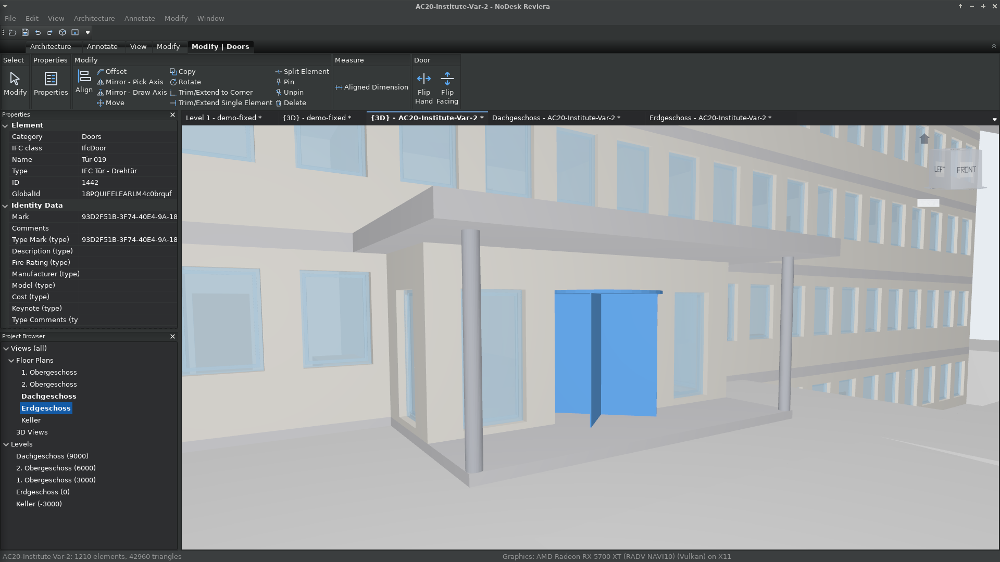
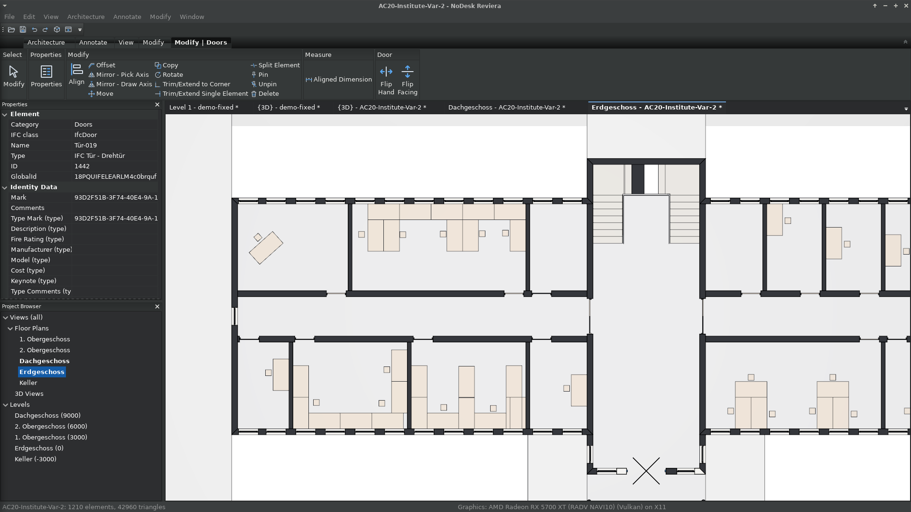
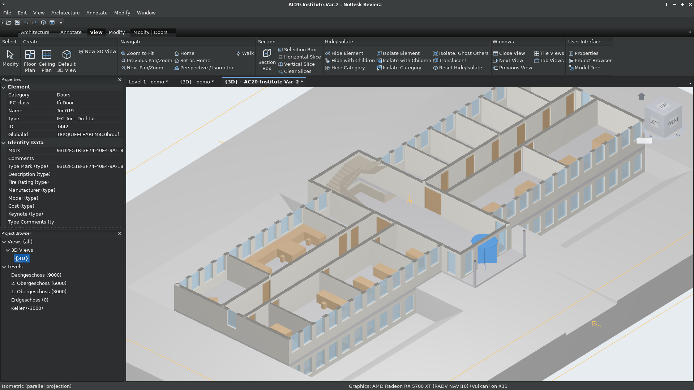
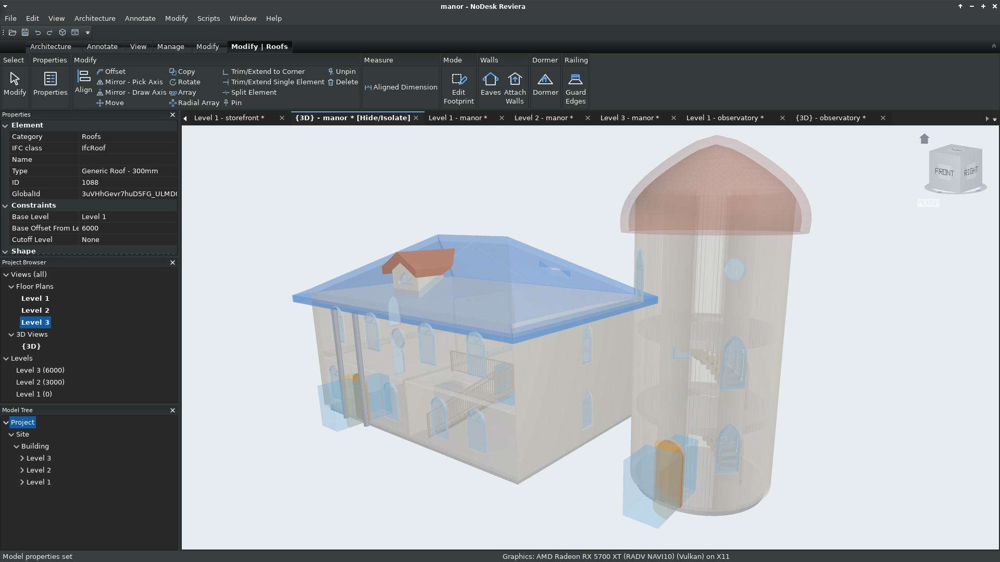
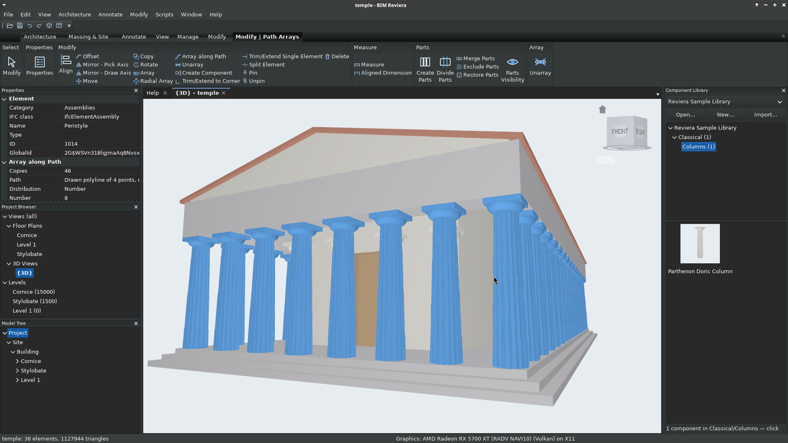
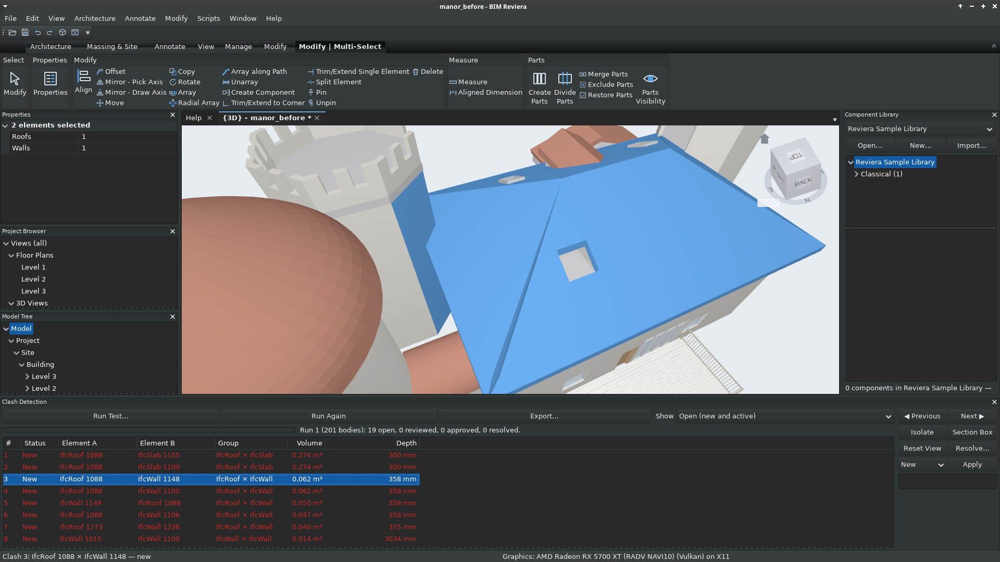

# BIM Reviera

**Open-source BIM authoring on native IFC: build anywhere, even from the beach.**


Reviera is a parametric Building Information Modeling (BIM) application for architecture,
structure and MEP. IFC is its native file format, so there is no proprietary container. Every
operation can be driven by Lua scripts and by AI agents through the Model Context Protocol (MCP).

> **Independence.** BIM Reviera is an independent, original application. It is in no way a copy or clone of
> any existing product, and it does not set out to read or write any existing product's
> closed, proprietary formats (such as RVT and RFA); IFC is its native format. An existing
> application was researched, from public sources only, to establish the workflows and
> user-interface conventions that the industry's users already know, so they can work in
> Reviera without relearning their trade. Beyond that research, Reviera implements its own
> features and enhancements: its architecture, native IFC storage, scripting and AI
> integration, remote computation and analysis, and many of its modelling tools are its
> own design. Interchange formats used across the industry, such as DWG and DXF, are
> supported only through open-source libraries, for interoperability.

> **Status: early development.** The specification is complete as a draft. The application
> already models a small building end to end: straight and curved walls, doors and windows,
> floors, ceilings, decks, hip, gable, arched and domed roofs with eaves and dormers, stairs,
> railings with gates, rooms, levels and grids. It finds and resolves overlaps with kept
> booleans (OpenCASCADE), checks door clearances, and draws plans, ceiling plans, sections,
> elevations, schedules and sheets to PDF and COBie. Every operation is a command that the
> ribbon, Lua scripts and AI agents (MCP) share. The newest work is components: Component
> Libraries of ordinary 3D files and IFC components, placed like stamps, made from any selection,
> and repeated along paths parametrically (see the Greek temple sample). Pre-release packages
> are built for Linux (Flatpak) and Windows.

## Contents

- [Screenshots](#screenshots)
- [What works today](#what-works-today): [platform](#platform-and-file-format),
  [automation](#commands-scripting-and-ai-agents), [modelling](#modelling),
  [components and libraries](#components-and-libraries),
  [coordination](#overlaps-booleans-and-clearances), [structure](#structure-in-development),
  [analysis and remote computation](#analysis-and-remote-computation-in-development),
  [documentation](#views-and-documentation),
  [inspecting and editing](#inspecting-and-editing), [the window](#the-window)
- [Sample models](#sample-models)
- [Not built yet](#not-built-yet)
- [Building](#building), [Trying it](#trying-it), [Repository layout](#repository-layout)

## Screenshots

The KIT FZK *AC20-Institute-Var-2* sample model (`test-data/ifc/`) open in Reviera, October 2026.







The Manor sample (`test-data/samples/manor.ifc`), drawn see-through in a Hide/Isolate view, with
its roof selected and the Modify | Roofs tab open: the dormer, the spiral stairs inside the tower,
the porch columns and the shaped windows show through the walls.



The Greek temple sample: 46 Doric columns from the sample Component Library (shown in the
Component Library pane on the right), placed round the stylobate by one parametric path array.
The array is selected: every copy highlights as one element, the contextual Modify | Path Arrays
tab offers Unarray, and Properties shows the array's own parameters (46 copies along a drawn
polyline, distributed by number) for editing.



Clash detection on the *Manor before coordination* sample. A clash test of every element against
every other ran out of process and found 19 clashes among 201 bodies, listed in the Clash
Detection pane with their category pair, volume and depth. Clash 3 is picked: the house's roof
and a castle tower's wall are selected and the 3D view is framed on where the wall runs up
through the eave, ready to review, comment on or resolve.



## What works today

Command names are given in `code` after each feature; every one of them can be run from the
ribbon's tools, the command shell, Lua and MCP alike.

### Platform and file format

- **Native IFC** through IfcOpenShell and OpenCASCADE: open, edit, save and tessellate IFC2X3,
  IFC4 and IFC4X3_ADD2 models, with lossless round trips of files from other tools. Elements
  Reviera does not model itself (furniture, imported stairs, equipment) are kept, drawn and
  selectable.
- **Reviera elements are standard IFC.** Walls, slabs, roofs, stairs, railings, doors, windows,
  spaces, storeys and grids are written as ordinary typed IFC entities with their relationships
  (containment, voids and fills, path connections, interferences), so other tools see them.
  Reviera's own data (recipes, sketches, views, settings) is embedded as standard `Reviera_*`
  property sets (RXD), and Reviera reopens its elements as editable.
- **Element identity** (GlobalIds and stable internal IDs) survives save and reopen.
- **Transactions, undo and redo** through one command registry: every change is a transaction,
  undo groups bundle multi-step tools and scripts, and the history lists who did what (user,
  script or agent) (`edit.undo`, `edit.redo`, `edit.history`, `element.changed_since`).
- **Crash recovery.** Every change is mirrored to an encrypted SQLite live store (SQLCipher,
  with the key kept in the OS keyring). After a crash, unsaved work and its undo history come
  back; the window offers to restore it (`recovery.list`, `recovery.restore`,
  `recovery.show_changes`, `recovery.discard`, `live.*`).
- **Units**: SI storage with project display units (metric and imperial, feet-and-inches);
  every length field accepts typed units (`4.5 m`, `12' 6"`) (`units.get`, `units.set_preset`,
  `units.set_format`, `units.set_number_format`, `units.format`, `units.parse`).
- **Help** (Help › Reviera Help, F1): a help tab beside the views with getting started,
  navigation and selection basics, pages for the Architecture and Structure tools (framing,
  foundations, settings and standards, the analytical model and its checks, loads, analysis and
  results), and the sample models grouped by the part of the application they show, each opened
  (as a fresh copy) from its link. Help › About gives the version and licence.
- **Several models at once**: each opens in its own tabs; File › Close Model (Ctrl+Shift+W)
  closes the active one and its views, asking to save changes.
- **Model Properties** (Manage › Settings, UN; File menu): the model-wide settings in one dialog:
  units preset and number format, the **building code** (IBC, IRC, Approved Document K, NBC
  Canada, NCC Australia, DIN 18065 or custom) with its occupancy and the model's own stair
  headroom, and the accessibility rule set. Tools follow the model's code by default and may use
  another for one operation (`code.get`, `code.set`; DM-CODE-001).
- **Parameters**: built-in, project and shared parameters, bound to types or instances and
  written to IFC property sets; Properties edit them, with type parameters marked
  (`param.list`, `param.get`, `param.set`, `param.set_many`, `param.clear`, `param.definition`,
  `param.project.add/modify/remove`, `param.set_ifc_home`, `pset.set`, `pset.remove`).
- **Types**: wall, door, window, floor, ceiling, roof, stair, railing and grid types, duplicated,
  renamed and edited the same way, from Properties or commands (`type.list`, `type.duplicate`,
  `type.rename`, `type.set_param`, `element.set_type`).

### Commands, scripting and AI agents

- **One command registry**: 207 commands in 46 domains today, each with a JSON Schema, a
  summary and description, a permission level (`read_only`, `model_edit`, `full_scripting`)
  and attribution. `registry.list` and `registry.describe` list and explain them; the command
  shell (`reviera shell`) runs them with JSON arguments.
- **Lua scripting** (LuaJIT): `script.run` runs a script or a `.lua` file against the open model.
  `reviera.<domain>.<verb>{...}` (or `reviera.call`) runs any command, `reviera.ui.form{...}` asks
  the user for input (length, number, integer, checkbox, choice and text fields, with defaults,
  ranges and help, validated and asked again until valid), and `print` reports. A run is one undo
  step and rolls back entirely if it fails.
- **Plugins**: a folder whose `plugin.lua` returns `{title, description, run}`, or a single
  `.lua` file with a `-- title:` header. They are found in the built-in set, the user's library
  (`~/.config/reviera/plugins`) and `REVIERA_PLUGINS` folders (`plugin.list`, `plugin.run`,
  `script.import`, `script.remove`). The built-in **Castle Turret** plugin builds a round tower
  (walls, a cone, pointed, onion or hemispherical dome or battlements, and arrow slits) from a
  form; it is the scripting capabilities test.
- **Scripts in the window**: the **Scripts** menu has Run Script…, Import into Library… (a
  script or a plugin folder), Manage Library… (each known script with its description, to run,
  remove or import) and every known script. A script's form shows as a dialog in the model's
  units. Headless runs (shell, MCP, tests) answer forms from `answers` and the defaults.
- **MCP server** for AI agents (`reviera --mcp-stdio`): every command is a tool, grouped into
  toolsets (core, modeling, documentation, families, materials, project_setup, io,
  collaboration, analysis, scripting, admin) that agents enable as needed, with discovery
  tools, `query_elements` and `get_element`, undo/redo/history, undo groups, preview and
  confirm for destructive changes, and resources for documents and elements. Agents get the
  same transactions, warnings and permission checks as the user. **`get_view_image`** gives
  multimodal agents a PNG of a view so they can look at what they did: from the agent terminal,
  the view exactly as the user sees it in the window (camera, plan graphics, annotation,
  selection), after the agent's calls have been drawn; headless, plans and 3D views rendered
  offscreen.

### Modelling

#### Walls

- **Drawing**: Architecture › Wall (WA) draws chains of walls on a plan's level, snapping to wall
  ends, midpoints, wall lines, cut edges and 15° angles; type a length and press Enter, and
  Spacebar flips the exterior side. **Arc Wall** draws a wall through its start, end and a point
  on the arc; **Spline Wall** draws one smoothly through clicked points (Enter ends it). Walls
  appear at once, regenerated from their recipe (`wall.create`, `wall.set_location`,
  `wall.flip`).
- **Properties**: a selected wall's base level and offset, top (a level plus a top offset, or an
  unconnected height) and type (choose, Duplicate Type…, rename, width). With the Wall tool
  running, the type row picks the type new walls get (`wall.set_constraints`).
- **Joins**: walls that meet join at mitred L corners and T junctions, recomputed as they move;
  curved walls join straight ones with mitred corners. A join can be disallowed per end
  (`wall.set_join_allowed`, `wall.joins_query`).
- **Attach**: a wall's top attaches to a roof or dome above it, so gable walls rise to the ridge
  and a drum rises to its dome; the part above the roof's lowest point follows the roof
  (`wall.attach`, `wall.detach`; Modify | Walls › Attach Top/Base).
- **Curved walls** carry doors and windows along the curve (square to it), bound rooms, attach to
  roofs and save as faceted B-reps.
- **Location lines**: straight walls drawn on their centreline, core centreline, finish or core
  face; the line stays put through type changes and flips, and changing it leaves the wall in
  place (`location_line` on `wall.create`, `wall.set_location_line`; ARC-WALL-002).
- **Slanted and tapered walls**: straight walls lean by an angle from vertical, or taper with
  their own exterior and interior angles, the type's variable layer taking the difference
  (refused if it would reach zero); saved as B-reps (`wall.set_cross_section`; the
  Cross-Section rows in Properties; ARC-WALL-005).
- **Linings, Auto Join and hosted walls** (Modify | Walls › Linings, Pick New Host, Remove
  Hosted, Select Main Host): finish walls against walls' faces or round rooms; Join Geometry
  between touching parallel walls so inserts cut both, optionally locked; hosted walls follow
  their host (`wall.create_by_segment`, `wall.create_by_room`, `wall.set_host`,
  `wall.remove_host`, `wall.select_main_host`, `geometry.join`, `geometry.unjoin`, `auto_join`
  on `wall.create`; ARC-WALL-014/015/016).
- **Wall sweeps and reveals** (Modify | Walls › Sweep, Reveal): a rectangular or typed profile
  along walls' faces, horizontal (continuing round joined walls, mitred) or vertical; reveals,
  and sweeps that cut, subtract from their walls; IFC `IfcCovering` MOLDING and
  `IfcOpeningElement` RECESS (`wallsweep.create`, `wallreveal.create`, `wallsweep.set`,
  `wallsweep.add_walls`, `wallsweep.remove_walls`; ARC-WALL-010).
- **Edit Profile** (Modify | Walls): a straight wall's elevation outline as loops of points
  (gables, steps, notches, holes), points keeping to the nearer end and the nearer of base and
  top; Reset Profile (`wall.edit_profile`, `wall.reset_profile`, `wall.get_profile`;
  ARC-WALL-009).
- **Stacked walls** (Modify | Walls › Edit Stack, Break Up): basic wall types stacked in rows,
  one Variable, offset from a chosen reference; IFC `ELEMENTEDWALL` aggregating one `IfcWall`
  per row; Break Up keeps the sub-walls' GlobalIds (`stackedwall.set_rows`,
  `stackedwall.create_type`, `wall.break_up`; ARC-STKW-001).
- **Split with Gap and Split Horizontally** (Modify | Walls): a joint gap of 1.6–305 mm held by a
  locked distance between the new ends, or a lower and upper wall at a level or height, inserts
  going to the part they sit in (`element.split_with_gap`, `wall.split_horizontal`;
  ARC-WALL-011).
- **Regions, extendable layers and wrapping**: a layer's column split at a height from the base
  or top into its own material (a brick plinth), unlocked layer edges moved by a wall's Top/Base
  Extension Distance, and wrapping layers lining openings' jambs and turning round free ends;
  layered walls drawn in their materials' colours and written as B-reps
  (`compound.set_regions`, `compound.split_region`, `compound.set_extendable`,
  `compound.set_wrapping`, `wall.set_extension`, `wall.set_end_wrap`; ARC-CMPD-003/004,
  ARC-WRAP-001).
- **Layers** (Modify | Walls › Edit Assembly): a wall type's layers, exterior first, each with a
  function, priority, material, thickness and wrapping, and the core; validated as the
  specification asks. The type's width is their total, plans draw the layer boundaries in cut
  walls, and IFC gets an `IfcMaterialLayerSet` with an `IfcMaterialLayerSetUsage` per wall
  (`compound.get`, `compound.set_layers`; ARC-CMPD-001/002).
- **IFC**: `IfcWall` with an `Axis` and a `SweptSolid` body (curved and attached walls as faceted
  B-reps in the wall's own frame), typed, contained in its storey and connected to its
  neighbours with `IfcRelConnectsPathElements`.

#### Doors and windows

- Architecture › Door (DR) and Window (WN) place them in walls (straight or curved) in plans or
  3D. The preview follows the cursor along the wall, the cursor's side sets the facing and
  Spacebar flips a door's hand.
- **Fitting**: a new one fits the wall where it lands. It slides or shrinks into the free gap,
  and on a dormer it rises above the main roof and shrinks under the dormer roof. The preview
  shows the fitted size.
- **Editing**: drag a selected one along its wall, or type its distance from either end of the
  wall. Properties edit the sill height (the head height follows), its own width and height (or
  the type's), the hand and facing, and the type (door and window types to duplicate and resize).
- **Shapes** (ARC-WIN-002): a type's Shape in Properties makes it round, elliptical, round-top
  (semicircular, segmental, elliptical, Gothic or Tudor heads), a fan light, gable-headed, a
  trapezoid or a polygon, with its own values (rise, radius ratio, sides, rotation, side
  heights) and radiating or upright glazing bars. Doors take round-top heads. The wall's opening,
  the frame (at a constant width along arcs) and the glass follow the outline; plans cut it at
  its true width at the cut height; fitting keeps a round window round and a semicircular or
  Gothic head's shape.
- **Door operations** (ARC-DOOR-002): a door type opens as a single or double swing, a
  revolving door (its width the drum) or an automatic bi-parting sliding door, with solid or
  glass storefront leaves and an automatic operator. A sliding door takes the wall its leaves
  slide over (fitting, refusals and a *slide space* virtual volume); plans draw each kind's
  symbol; IFC writes the operation type and `HasDrive`.
- Walls are cut, plans show door swings, and each new door or window gets the next Mark.
- **IFC**: `IfcDoor`/`IfcWindow` filling an `IfcOpeningElement` that voids the wall (`door.place`,
  `window.place`, `insert.set_position`, `insert.set_sill_height`, `insert.set_size`,
  `insert.flip_hand`, `insert.flip_facing`). A shaped one's opening is its outline extruded
  through the wall (an `IfcCircleProfileDef` for a round window), and a shaped window says
  `PartitioningType = USERDEFINED` with its shape.

#### Sketch mode

Floors, ceilings, decks and roof footprints are sketched in a plan on a contextual *Modify |
Create … Boundary* tab:

- **Pick Walls** takes the wall face on the cursor's side, locked so the element follows the
  wall. Tab takes the whole chain of walls joined or meeting end to end. A curved wall gives its
  face's curve.
- **Line**, **Rectangle**, **Arc** (start, end, a point on it) and **Circle** (centre and a
  point) draw free curves, snapping like the drawing tools. Sketch curves may pass through
  points (`through`: one point makes an arc, more a spline).
- **Modify** selects curves to drag, delete or edit (length; for roofs slope, overhang and
  Defines Slope). Delete removes the selected or the last curve.
- **Finish** checks the sketch: open ends, branches, crossings and overlaps are marked in red
  and the session stays open. Inner loops make holes. **Cancel** discards it.
- A finished floor, ceiling, deck or roof shows its outline with grips when selected. Dragging an
  edge or a corner changes it in place, as one undoable edit, and Edit Boundary / Edit Footprint
  reopens the sketch (`sketch.move_curve`, `sketch.move_corner`).

#### Floors and ceilings

- **Floors**: Architecture › Floor (FL) sketches a floor. Floors have types with a thickness and a
  height offset, and show area, perimeter and volume in Properties. Saved as `IfcSlab` with an
  extruded profile (`floor.create`, `floor.edit_boundary`, `floor.set_level`).
- **Ceilings**: Architecture › Ceiling places an automatic ceiling in the room under the cursor
  (its edges follow the walls' finish faces, round rooms included, and move with them), or
  Sketch Ceiling. Ceilings have types and sit 2600 mm above their level by default. A ceiling
  can follow the roof over it (Shape: Follow Roof, in the Ceiling tool or Properties): vaulted
  under a pitched roof, curved under an arched roof or a dome. Saved as `IfcCovering` (CEILING)
  (`ceiling.create_auto`, `ceiling.create`, `ceiling.edit_boundary`, `ceiling.set_shape`).
- **Curtain walls** (Architecture › Curtain Wall): two clicks draw one; its type lays out the
  vertical and horizontal grid lines (Fixed Distance, Fixed Number, Maximum or Minimum Spacing,
  with the instance's justification and offset), mullions and glazed, solid or empty panels.
  Drawn along a wall, it cuts its own opening. IFC: `IfcCurtainWall` aggregating `IfcPlate`
  panels and `IfcMember` mullions (`curtain.create`, `curtain.set`; ARC-CW-001 … 006,
  ARC-WALL-013).
- **Curtain grid edits and doors** (Modify | Curtain Walls › Edit Grid): manual grid lines,
  removing segments to merge panels, and swapping panels for glazed, solid, empty or a
  curtain-wall door (an `IfcDoor` in the curtain wall) (`curtain.add_grid`,
  `curtain.set_grid_segments`, `curtain.move_grid`, `curtain.delete_grid`,
  `curtain.set_panel_type`, `curtain.set_layout`; ARC-CW-004/006).
- **Sloped glazing** (Modify | Roofs › Sloped Glazing): a roof of a Sloped Glazing type becomes
  glass panels and mullions on its planes, Grid 1 parallel to the eaves and Grid 2 up the slope,
  hip and ridge mullions shared (`roof.create_glazing_type`, `roof.set_glazing_type`;
  ARC-CW-008).
- **Columns** (Architecture › Column): architectural columns of rectangular or round types,
  placed by clicking in a plan (Spacebar turns them 90°), from a base level to a top level or a
  height. Attach Top (Modify | Columns) attaches their tops to the roof, floor or ceiling above,
  cut by a sloped underside. They move, rotate, mirror and copy, and are written as `IfcColumn`
  (`column.place_architectural`, `column.set`, `column.attach`, `column.detach`; ARC-COL-001).
- **Openings** (Architecture › Opening):
  - **Wall Opening**: hover a wall and click to cut a rectangular hole of the tool's width and
    height through a straight or curved wall. Its base and top follow levels; it slides along the
    wall and moves, copies and goes with it (`opening.create_wall`, `opening.edit_wall`;
    ARC-WALL-012, ARC-OPEN-003).
  - **Vertical**: sketch loops in a plan; Finish cuts the floor (or ceiling) on the level they
    overlap most, else a roof, plumb; one partly outside notches the edge. Plans draw it crossed
    corner to corner; its grips reshape it; it moves with its host and goes with it
    (`opening.create_vertical`, `opening.set_loops`; ARC-OPEN-002).
  - **Shaft**: sketch loops; the shaft cuts every floor, ceiling and roof between its base and top
    levels, including ones added later (`opening.create_shaft`, `opening.edit_shaft`;
    ARC-OPEN-004).
  - IFC: an `IfcOpeningElement` voids each host, whose own body stays whole; a shaft is an
    `IfcBuildingElementProxy` (PROVISIONFORVOID) with one derived opening per host.
- **Skylights** (Architecture › Opening › Skylight): click a roof in a plan or 3D. A pitched
  roof gets a roof window lying in the slope; a flat roof a flat sheet, a pyramid or a ridge
  lantern on a curb. A ridge lantern's panes are re-mapped from its length (as many equal panes
  as keep each within the largest pane size). Each cuts its own opening and moves with its roof.
  IFC: `IfcWindow` (SKYLIGHT) filling an `IfcOpeningElement` in the roof (`skylight.create`,
  `skylight.set`; ARC-WIN-001).

#### Roofs

- **Footprint roofs**: Architecture › Roof sketches a footprint. Pick Walls takes the walls'
  exterior faces with a 600 mm overhang and puts the roof on the walls' tops, and offers to
  attach the walls. A weighted straight skeleton makes hip, gable, shed, pavilion and cut-off
  (mansard) roofs from any simple footprint, with different slopes per edge and courtyards
  (falling to the street and to the courtyard, or a flat slab with the courtyard as a hole).
  Each face is a mitred slab of the type's thickness. Properties choose the Roof Shape (Hip,
  Gable, Gable rotated, Shed, Shed reversed or Flat), overhang, base offset, slope, cutoff level
  and type (`roof.create_footprint`, `roof.edit_footprint`, `roof.set_params`, `roof.set_edge`,
  `roof.set_slope`, `roof.set_shape`).
- **Attach Walls**: Modify | Roofs › Attach Walls attaches every perimeter wall under a roof at
  once; interior walls stay as they are (`roof.attach_walls`).
- **Eaves**: Modify | Roofs › Eaves makes a roof's sloped edges bear on the walls below. The
  overhang is measured from the wall's exterior face. The bearing is the exterior face, the core
  centre or the interior face, and a heel height raises the roof. The rafter cut is plumb, square
  or two-cut. A fascia and a soffit (boxed, sloped or open) return to the wall's face, mitred at
  hips. A roof made from picked walls gets eaves by default (`roof.set_eaves`, `roof.eaves`).
- **Dormers**: Modify | Roofs › Dormer places gable, hipped, shed (flat lift) or flat dormers
  where you click on a roof, in a plan or 3D. Each comes with its roof, a front wall and cheek
  walls down to the main roof, trimmed to its underside so the cheeks follow the slope. Its roof joins the main roof flush: it reaches back until its top
  meets the main roof's and is cut along it, so the two meet in valleys and rain runs off. The
  main roof is cut open below the dormer, inside its walls. Windows fit the dormer's front wall.
  Properties change the style, width, front height, slope and overhang; deleting the dormer (or
  its roof) removes its parts (`dormer.create`, `dormer.set`, `dormer.move`).
- **Arched roofs**: Architecture › Arched Roof sketches a four-sided footprint and makes a smooth
  barrel or segmental vault springing from the longer sides (semicircle, segment, elliptical and
  catenary profiles). Over a trapezoid it tapers, keeping its rise or its slope at the springing.
  Rise, overhangs and profile are in Properties, and the end walls attach up to the arch
  (`roof.create_arched`, `roof.set_arch`).
- **Domes**: Architecture › Dome places a hemisphere, segmental, pointed or onion dome over a
  circle, an ellipse, or a square, hexagonal or octagonal cloister vault, with an optional
  oculus and faceting. Properties edit the centre, radius (a hemisphere's rise follows), sides,
  rotation, rise, profile ratio and oculus (`roof.create_dome`, `roof.set_dome`).
- **IFC**: `IfcRoof` with faceted B-rep bodies (`BARREL_ROOF` and `DOME_ROOF` for curved roofs).

#### Stairs, railings and decks

- **Stairs**: Architecture › Stair (ST) draws a cast-in-place stair: click the start and end of
  each run while the status bar counts the risers down; the next run starts after an automatic
  landing (straight, L and U arrangements). The riser count is the fewest that keep each riser
  within the type's maximum (180 mm by default), and runs hold what their length allows at the
  tread depth. Properties set the desired risers, tread depth and width and show the actual
  riser height and warnings. **Spiral Stair** makes a full-step spiral from its centre and a
  point on its walking line; **Winder Stair** an L winder from its start, corner and turn, its
  treads balanced round the corner (ARC-STAIR-004). New stairs get railings on both sides. Saved as `IfcStair`
  (`stair.create`, `stair.set_params`).
- **Ramps** (Architecture › Ramp): click a centreline in a plan from the bottom up. Corners get
  square landings, and a run longer than the type's maximum incline length (9 m) is split by
  landings. A slope steeper than the type's maximum (1:12) gives a warning. Thick or solid
  shapes; `IfcRamp` (`ramp.create`, `ramp.set`; ARC-RAMP-001).
- **Stairs through floors** (ARC-STAIR-007): a run drawn to within a tread of the top snaps to
  reach the level above and completes the stair; Esc completes it too, the last run carrying on.
  The stair keeps reaching its top as levels move, and its railings extend with it. Where a floor
  or ceiling over it leaves less headroom than the building code asks (from the nosing line), the
  stair offers to open it over its full width, under the model's code or another one (each listed
  with its headroom and clause); Modify | Stairs › Stair Openings offers it again
  (`stair.headroom_check`, `stair.create_openings`).
- **Railings**: Architecture › Railing sketches a guard railing's path (sketched over a deck,
  floor or flat roof, it stands on its top). Modify | Floors / Roofs › Guard Edges puts railings
  along every open edge of a deck, patio, floor or flat roof, leaving out edges with a wall
  along them, and they follow the host's outline. Stair railings follow the nosing line and
  run flat across landings, round the outside of a turn (Modify | Stairs › Railings). Each has a
  top and bottom rail, posts at the ends and corners, and balusters spaced by the type
  (`railing.create`, `railing.create_on_edges`, `railing.create_on_stair`).
- **Openings and gates**: Modify | Railings › Opening, Gate and Double Gate: click on the railing
  where each goes. An opening gets a post each side; a gate fills it with one or two leaves,
  swinging in or out, and is its own `IfcDoor` (GATE) (`railing.add_opening`,
  `railing.add_gate`, `railing.move_feature`, `railing.remove_feature`, `railing.features`).
- **Decks**: Architecture › Deck sketches a deck's outline. Its boards are laid out one by one:
  courses across from the start edge (the last ripped, or balanced), every end joint on a joist
  and staggered, picture-frame borders mitred at the corners, and pieces cut from the shortest
  stock length that fits, with offcuts reused. The framing is laid out too: joists, beams, posts
  and footings. Properties change the board width, gap, direction, stock lengths, frame,
  stagger and spacings and show the cut list (boards, stock to buy, framing, screws). A deck is
  a floor, so outline grips, Edit Boundary and Guard Edges work on it (`deck.create`,
  `deck.set_boards`, `deck.set_framing`, `deck.boards`, `deck.cut_list`).

#### Rooms, levels and grids

- **Rooms**: Architecture › Room (RM) places a room in the region of wall faces under the cursor,
  shown as you hover; Place Rooms Automatically fills every enclosed region of the level,
  numbered in reading order. Rooms measure to the walls' finish faces (curved walls included),
  leave out islands such as free-standing walls, follow their walls, and become Not Enclosed if
  the walls open up. Plans label each room with its name, number and area. Saved as `IfcSpace`
  (Name = Number, LongName = Name) under its storey (`room.place`,
  `room.place_automatically`, `room.set`).
- **Stair annotation**: plans draw stair paths with UP/DN and cut marks; Number Treads numbers a
  stair's treads in a view, kept when it moves (`stair.number_treads`; ARC-STAIR-006).
- **Masses and model by face** (Massing & Site): in-place masses (extrusions, lofts, …) from
  model-line loops, mass floors with areas, volumes and exterior surfaces that follow the mass,
  walls, floors, roofs and curtain systems by face with Update to Face (`mass.create`,
  `mass.set_floors`, `mass.floors`, `wall.create_by_face`, `floor.create_by_mass_floor`,
  `roof.create_by_face`, `curtainsystem.create_by_face`, `element.update_to_face`;
  ARC-MASS-001 … 003, ARC-ROOF-003, ARC-CW-007).
- **Site** (Massing & Site): toposolids from a boundary or a points file, with contours in plans
  at the site settings' interval; sub-divisions that raise paths or excavate roads (with the
  excavated volume); graded regions with exact cut and fill; Simplify Surface within a reported
  vertical error; property lines sketched or typed as distances and bearings, with their area;
  site components that stand on the ground and follow it (`toposolid.create`,
  `toposolid.subdivide`, `toposolid.create_graded_region`, `toposolid.cut_fill`,
  `toposolid.simplify`, `site.set_settings`, `propertyline.create`, `sitecomponent.place`;
  ARC-TOPO-001 … 005, ARC-SITE-001).
- **Parts** (Modify › Parts): walls split into one part per layer (openings and joins
  included) and floors, ceilings, roofs, columns and beams into one part each, following their
  element; divided by lines or by levels, grids and reference planes with a gap, merged,
  excluded and restored; their own material and level; Show Parts, Show Original or Show Both
  per view; `IfcBuildingElementPart`s aggregated by their element in IFC (`parts.create`,
  `parts.divide`, `parts.merge`, `parts.exclude`, `parts.restore`, `parts.set_overrides`,
  `parts.info`, `view.set_parts_visibility`; ARC-PART-001 … 004).
- **Model In-Place** (Architecture › Model): free-form elements of a chosen category from
  extrusions, blends, revolves and sweeps on work planes, solid or void (voids cut through the
  boolean relations); made in the window from selected model lines (`inplace.create`,
  `inplace.add_form`, `inplace.remove_form`; ARC-INPL-001).
- **Model Text** (Architecture › Model): 3D lettering on a work plane, each letter a solid with
  its holes, any depth (`modeltext.create`, `modeltext.set_text`; ARC-MTXT-001).
- **Groups** (Architecture › Model, Modify | Model Groups): model groups made from a selection
  and placed by clicking, members read-only outside the group editor (Add, Remove, Finish
  remakes every instance, Cancel), excluding and restoring members per instance, Ungroup;
  `IfcGroup` with `IfcRelAssignsToGroup` (`group.create`, `group.place`, `group.edit`,
  `group.finish`, `group.cancel`, `group.exclude_member`, `group.ungroup`, …;
  ARC-GRP-001 … 003).
- **Saved selections** (Manage › Selection): Save and Load Selection (members hidden in the view
  left out unless asked for), Edit Selection mode (picks and window selections add or remove,
  Finish is one step), and the project option to export sets as `IfcGroup`s
  (`selectionset.save`, `selectionset.load`, `selectionset.edit`, `selectionset.list`,
  `selectionset.set_export`; ARC-SEL-002). Not built yet: the shared name space with view
  filters.
- **Room separators** (Room & Area › Room Separator): lines or arcs that split space for rooms
  like walls (`roomseparator.create`; ARC-ROOM-001).
- **Areas and area schemes** (Architecture › Area): Gross Building and Rentable schemes with area
  types and boundary rules, area plans (boundaries on the outside walls), picked boundaries
  placed by the rules for the areas either side, and areas (`areascheme.create`,
  `areascheme.set_rules`, `areaplan.create`, `areaboundary.create`, `area.place`,
  `area.set_type`, `area.list`; ARC-AREA-001).
- **Colour schemes** (Room & Area › Color Schemes): rooms or areas filled in plans by a
  parameter's value (new values coloured from a palette) or range (`colorscheme.create`,
  `colorscheme.set_rows`, `colorscheme.legend`, `view.set_color_scheme`; ARC-CLR-001).
- **Levels**: Architecture › Level (LL) adds a level with its floor plan, named after the level
  below. Name and Elevation are edited in Properties; moving a level moves the walls on it and
  stretches the walls up to it; deleting one lists what goes with it first. Saved as
  `IfcBuildingStorey` (`level.create`, `level.set_elevation`, `level.rename`, `level.list`).
- **Grids**: Architecture › Grid (GR) draws grid lines with snapping; names continue the series
  (1, 2, 3 … or A, B, C). Grids show in every plan and in PDF with their bubbles, are renamed in
  Properties and dimensioned, and dimensions follow a moved grid. Grid types set the bubble, a
  continuous, gapped or custom centre segment, and the pens and patterns. Saved as one `IfcGrid`
  with an `IfcGridAxis` per line; axes changed in another tool are taken over on open
  (`grid.create`, `grid.rename`, `grid.set_curve`, `grid.list`).
- **Drawing aids**: typed lengths with arithmetic (`1200+600`, `(2*900)/2`, `8 6`) in the
  Wall, Grid, Ref Plane, Model Line and Scope Box tools; temporary dimensions on a selected wall,
  grid, reference plane, door or window, typed to move it (`dim.temporary_query`,
  `dim.temporary_set`, `dim.make_permanent`; ARC-DIM-001/002); Tab cycles what is under the
  cursor, the chain of joined walls included (ARC-KEY-001).
- **Exact coordinates**: every tool that takes points is sketched with the mouse or given
  exact coordinates. Coordinates (`XY`) lists the points of the sketch in progress to type or
  correct (a sketched line put exactly in place), hands typed points to any other tool as
  clicks, or edits a selected wall's, beam's, grid's, plate's or reinforcement system's ends,
  contour, boundary or path; `x, y`, `@dx, dy` and `@distance<angle` (UI-A11Y-001). Not yet:
  typing straight into the canvas without the dialog.
- **Constraints**: dimension locks, EQ and alignment locks between walls, grids and reference
  planes, kept by a solver in every edit, which refuses edits they cannot follow; Reveal
  Constraints (`constraint.lock_dimension`, `constraint.unlock_dimension`,
  `constraint.set_equality`, `constraint.lock_alignment`, `constraint.delete`,
  `constraint.list`, `view.reveal_constraints`; ARC-CNST-001/002).
- **Roofs by extrusion**: a profile clicked in a section or elevation (Enter), or on a grid or
  reference plane by command, extruded across with the roof's thickness below it; a gable, shed,
  mansard or barrel (`roof.create_extrusion`, `roof.set_extrusion`; ARC-ROOF-002).
- **Slope arrows and joined roofs**: a slope arrow turns a gable end into a sloped plane (a hip);
  Join/Unjoin Roof extends a roof's edge to a wall's face or another roof's top surface
  (`roof.set_slope_arrow`, `roof.remove_slope_arrow`, `roof.join`, `roof.unjoin`;
  ARC-ROOF-005/006).
- **Slab edges**: a rectangular profile swept along a floor's edges in one mitred run, flipped and
  offset, following the floor; `IfcSlab` SLABEDGE (`slabedge.create`, `slabedge.set`,
  `hostsweep.*`; ARC-SLED-001).
- **Shape editing**: points and split lines warp a floor's top into flat facets (falls to a
  drain), the slab following at its thickness; Reset Shape (`shape.*`; ARC-SHAPE-001).
- **Openings by face**: sketched like vertical openings, cut square to a roof's face; saved as
  an `IfcOpeningElement` along the face's normal (`opening.create_by_face`; ARC-OPEN-001).
- **Datum extents**: levels, grids and reference planes have a 3D extent and, per view, a 2D
  extent, bubbles and grid elbows; Reset to 3D, Maximize 3D and Propagate Extents on their
  contextual tab (`datum.set_extent`, `datum.reset_to_3d`, `datum.maximize_3d`,
  `datum.propagate_extents`, `datum.set_bubble`, `datum.add_elbow`, `datum.get`;
  ARC-DATUM-001).
- **Scope boxes** (View › Scope Box): named, turnable boxes; datums assigned to one show only in
  views that cross it and are clipped to it, following it as it moves. Saved as `IfcAnnotation`
  with an `IfcBoundingBox` (`scopebox.create`, `scopebox.set_extents`, `scopebox.list`,
  `datum.assign_scope_box`, `view.assign_scope_box`; ARC-SCOPE-001).
- **Reference planes** (RP): unbounded construction planes drawn as a line in a plan, named to
  serve as work planes; dashed green in plans and in the sections and elevations that look along
  them. Saved as `IfcAnnotation` with an Axis (`refplane.create`, `refplane.rename`,
  `refplane.set`, `refplane.list`; ARC-REFP-001).
- **Work planes**: each view's active plane (a plan's level by default), set by name (level,
  grid, named reference plane) and shown as a grid. Elements on one follow it; Dissociate fixes
  them where they are (`workplane.set`, `workplane.get`, `workplane.show`, `workplane.list`,
  `element.set_work_plane`, `element.dissociate_work_plane`; ARC-WP-001).
- **Model lines** (LI): lines, arcs and chains on a work plane, in seven line styles, shown in
  plans, sections, elevations and 3D. Saved as styled `IfcAnnotation` curves (`modelline.create`,
  `modelline.set`, `modelline.list`, `modelline.styles`; ARC-MLIN-001).

### Components and libraries

Components are reusable objects (furniture, fittings, planting, columns, scanned statues, whole
pieces of a building) placed into a model as many times as needed. They come from **Component
Libraries**: plain folders of ordinary 3D files, readable by any other tool.

- **Component Libraries**: a library is a folder of OBJ (with its MTL and textures), STL, PLY,
  glTF/GLB and IFC files with one manifest, `reviera-library.json`, in its root. The manifest
  holds what the files cannot: names, categories, units, up axes, tags, product data and settings
  per folder (inherited by sub-folders). The files are never rewritten, so a library can live in
  git or a shared folder (`library.create`, `library.open`, `library.list`,
  `library.import_files`, `library.get_meta`, `library.set_meta`, `library.delete_items`,
  `library.restore_items`; DM-LIB-004).
- **The Component Library panel** (docked right; Window › Component Library, CL): the libraries
  you have open (remembered; the sample library at first), their folders with item counts, and
  each folder's components as thumbnails rendered by Reviera. Open… turns any folder into a library
  by adding only the manifest; New… makes one; Import… copies 3D files in, with their units and
  up axis set once and the size previewed.
- **Place Component** (Architecture › Component, CM): click a component in the panel to pick it
  up, like a stamp; each click places a copy until Esc, Spacebar turns the next one. In plans it
  snaps; in 3D a copy sits on the surface under the cursor. A library component becomes a type
  in the model on its first copy and every copy shares its geometry. Properties edit its details
  in the library's manifest (`component.place`; DM-LIB-002).
- **Import Object** (Architecture › Component): one 3D file straight into the model as a
  component type, with units, up axis, insertion point, category and name, its size previewed
  (`mesh_object.inspect`, `mesh_object.import`, `mesh_object.reload`; DM-IMP-015). Reviera reads
  OBJ, STL, PLY, glTF and GLB itself.
- **Create Component** (middle-click quick menu, Modify tab): any selection becomes a component,
  an IFC file of that piece of the model saved into the library folder shown. It brings what the
  selection needs (doors in its walls, hosts, types, levels). Placing it copies the elements in
  with new identities, maps its levels by height and reuses the model's types
  (`component.create`, `component.place_fragment`; DM-LIB-003).
- **Array along Path** (Modify, AP): repeats a component along a picked wall, grid line or floor
  edge, or a drawn polyline, arc or spline, by number or spacing, with counts per side, a copy at
  every corner, facing along, outward or inward, and seeded random turn and scale for planting.
  It stays parametric: change the count, the path or the component and every copy follows,
  even when the component is a plain scanned mesh. Unarray makes the copies independent
  (`array.along_path`, `array.set`, `array.exclude_member`, `array.restore_member`,
  `array.members`, `array.unarray`; ARC-MOD-033).
- **In IFC** a component type is its category's type class with its mesh written once (an
  `IfcRepresentationMap` of styled `IfcTriangulatedFaceSet`s) and each copy maps it
  (`IfcMappedItem`); a path array is an `IfcElementAssembly` of its members. Other IFC tools see
  them all. Types placed from a library record the library and item, never folder paths.
- **Properties** of placed components: offset, rotation, mirror and scale; the type's name,
  category, scale and material colours (`mesh_object.set`, `mesh_object.set_type`,
  `mesh_object.types`). Selected components and arrays get their own contextual tabs.

### Overlaps, booleans and clearances

- **Volume overlap engine**: View › Check Overlaps finds where elements' bodies overlap (walls,
  floors, roofs, stairs, railings, doors, windows and imported elements), listed largest first
  with volume and depth, and selects and frames a picked pair. Touching is not overlapping, and
  pairs that belong together by design (a door and its wall, a dormer and its roof, a gate and
  its railing) are left out (`overlap.find`).
- **Resolving**: a picked overlap is accepted as intended (it then drops out of the checks),
  moved apart, or resolved by a boolean: cut either by the other (optionally hiding the cutting
  body, as for a slot's cutter), join by precedence (floors and roofs cut walls, walls cut
  columns), intersect or union (`overlap.resolve`, `overlap.accept`, `overlap.accepted`).
- **Kept booleans**: computed by OpenCASCADE and re-made whenever either element changes;
  Modify › Remove Boolean takes them off. Saved as the shaped bodies with an
  `IfcRelInterferesElements` for each (`geometry.boolean`, `geometry.remove_boolean`).
- **Virtual volumes**: every door has its swing volume, and with the ADA 2010 rule set (View ›
  Accessibility Rules) its pull-side and push-side maneuvering clearances. Check Overlaps lists
  what intrudes into them (and doors that would hit each other). View › Virtual Volumes shows
  them hidden, translucent or solid in each view; they are never exported as physical
  elements (`clearance.set_rule_set`, `clearance.list`, `clearance.check`,
  `view.set_virtual_volumes`).

### Structure (in development)

The Structure epic has begun (spec Chapter 4 §4.1). A **Structure** tab carries the structural
tools and the datums.

- **Structural columns**: Column (`SC`) places load-bearing columns in plans; **At Grids** puts
  one at every crossing of the grid lines you select (a window in a plan now selects grids), in
  one undo step. Shapes are rectangular, round, I, channel, angle, tee and rectangular or round
  hollow sections, with their area and second moments computed from the outline. Each column
  shows a read-only location mark such as "B-2" (`column.place`, `column.place_at_grids`,
  `column.location_mark`; STR-COL-001). Attach Top and Detach Top work as for architectural
  columns.
- **Section catalogues**: **Load Section** (and Load Beam Section) makes a column (or beam) type
  from 325 standard sections in 14 catalogues: AISC W, C, L, WT, HSS and pipe; Euronorm IPE, HEA
  and HEB; UK UB and UC; North American sawn lumber (PS 20) and EN 336 timber, in the region's
  timber grade. Catalogues carry nominal dimensions only, with sources
  (`crates/reviera-core/data/sections`). A **materials library** of 35 steel grades, concrete
  classes and timber grades gives their strengths and moduli (`structural.materials`).
- **Beams**: Beam (`BM`) draws beams in plans, a click at each end, chained; **On Grids** puts one
  in every bay between columns along the selected grid lines. Their tops are at the level (each
  end can be offset, so beams slope). Each end joins what it rests on, a column, a wall or the
  side of another beam, stopping at its face less a 12.5 mm cutback for steel; ends can be
  disjoined and extended. Usage follows the supports when automatic (on columns a girder, on
  girders a joist, on joists a purlin, written as IfcMember) or is set by hand. y and z
  justification, orientation for sloped beams and cross-section rotation are in Properties
  (`beam.create`, `beam.create_on_grids`, `beam.set`, `beam.set_usage`, `beam.info`,
  `framing.set_justification`, `framing.set_extension`, `framing.set_cutback`,
  `framing.disjoin`, `framing.join`; STR-BEAM-001, 002). Plan snapping now finds grid crossings.
- **Beam systems**: Beam System (`BS`) fills a bay of beams or walls with joists, parallel to the
  nearest support, by maximum spacing, fixed distance, fixed number or clear spacing. The bay's
  edges are locked to their supports, so the joists re-space when a girder moves; Remove Beam
  System keeps the joists (`beam_system.create_auto`, `beam_system.create_sketch`,
  `beam_system.set_layout`, `beam_system.remove`; STR-BSYS-001).
- **Trusses**: Truss (`TS`) draws Pratt, Howe, Warren, Fink, King post or Queen post trusses,
  flat, gable, mono-pitch, scissor or bowstring, with heel posts, or any chord shape (Edit
  Profile); a top chord can follow a roof's underside. Stretched, a truss keeps its panels and
  re-proportions its webs. It is an IfcElementAssembly (TRUSS) aggregating its chords (split
  where they bend) and webs; Remove Truss keeps the members (`truss.create`, `.set`,
  `.edit_profile`, `.attach`, `.detach`, `.remove`; STR-TRUSS-001).
- **Braces and slanted columns**: Brace (`BR`) draws a brace from this level to the next; an end
  on a column or beam attaches to it and follows it when it moves, stretches or changes level, and
  is freed (with a warning) if the member is deleted. Braces are IfcMember (BRACE); level ones are
  horizontal bracing. Slanted Column places a column from a base to a top on the next level, end
  point or angle driven (`brace.create`, `column.place_slanted`, `column.set_slant`; STR-BRACE-001,
  STR-COL-002).
- **Foundations**: isolated footings, clicked in a plan, at grid crossings, or under the selected
  columns (joined: they follow the column, their tops at its base); wall foundations under walls,
  bearing or retaining (toe and heel), following the wall; and foundation slabs, sketched, their
  thickness below the level. Default sizes follow the region (`footing.place`,
  `footing.place_at_columns`, `footing.place_at_grids`, `wall_foundation.create`,
  `foundation_slab.create`, `foundation.info`; STR-FND-001 … 003).
- **Structural walls and floors**: Structure › Wall draws bearing walls (shear and structural
  combined in Properties: IfcWall SHEAR or SOLIDWALL, load-bearing); Structure › Floor sketches
  structural floors with a span direction (`wall.set_structural_usage`, `floor.set_structural`,
  `floor.set_span_direction`; STR-WALL-001, STR-FLOOR-001).
- **Structural Settings and Coarse plans**: Structure › Structural Settings edits brace symbols,
  the coarse cutback, point-to-point steel, analytical tolerances and load display scales; a
  plan's Detail Level set to Coarse draws beams, braces and truss members as single lines
  (`structural_settings.get`, `structural_settings.set`, `view.set_detail_level`; STR-SET-001,
  DOC-GFX-010).
- **Connections and piles**: Connection (`CN`) places a connection at the join of the
  selected members, carrying approval, code-check and fabricator information (a circle with spokes
  in plans); Pile and Pile Cap place bored or driven piles, a cap's piles laid out under it and
  aggregated by it (`structural_connection.create`, `pile.place`, `pile_cap.place`;
  STR-CONN-001, STR-FND-004).
- **Steel connection library** (built-in types): Connection offers the types that fit the
  selection: Shear Plate, Extended End Plate, Base Plate (with anchor rods, one per selected
  column) and Gusset (for braces), or Generic. They make plates, bolts and welds as elements of
  their own (IfcPlate, IfcMechanicalFastener, IfcFastener, aggregated by the connection), drawn
  only at Fine detail and kept in step with the members. Parameters come from the region's
  defaults, the project's values for the type, then the connection's own overrides; Properties
  show a connection's type and parameters by tab (`connection_type.list`,
  `connection_type.edit_parameters`, `structural_connection.set_type`,
  `structural_connection.override`; STR-STL-001, STR-STL-002). Not yet: Lua library packages,
  the other connection groups (clip angles, splices, haunches, stiffeners), the Modify Parameters
  dialog with live preview, copes and cuts.
- **Steel detailing** (the Steel tab): plates sketched on a face of a column, beam, brace or
  plate (following it) or on a work plane, with thickness, justification and role; bolt, anchor,
  hole and shear stud patterns through the selected elements, their grip, bolt length and holes
  found from the elements' bodies (holes cut in them and written to IFC as openings); welds on an edge where the
  elements touch within 1 mm, flagged for review when the elements change (`plate.create`,
  `bolt_pattern.create`, `anchor_pattern.create`, `hole_pattern.create`,
  `shear_stud_pattern.create`, `weld.create`, `weld.edges`, `face.list`; STR-STL-005/006/007).
  Any command taking a work plane also takes a face. Not yet: assembly marks, weld symbols in
  drawings.
- **Steel cuts and modifiers**: cope (following the main member's depth), skewed cope, miter,
  saw cut, shorten and extend, contour cut, cut through and cut by, plate corner cuts, and
  Uncope; cuts are elements whose cutters are subtracted from the members' bodies by the solid
  kernel and written to IFC as openings, grouped in sub-connections (`steel_cut.*`,
  `steel_modifier.*`; STR-STL-008). Not yet: the sub-connection box in views, shape handles,
  copes made by connection types.
- **Custom connections**: Customize makes a connection type of the connections, plates, bolts and
  welds at a join (up to three members), placed on joins with the same members' roles, sections
  and way of meeting; Add, Remove and exposed parameters change every instance after confirming
  the count (`structural_connection.customize`, `custom_connection.*`; STR-STL-003). Not yet:
  profiles and cuts as parts, the edit mode with half-toning.
- **Connection code checking**: design forces on connections, checks through connection design
  providers (Lua plugins with `capability = "connection_check"`; a simplified MIT sample for bolt
  shear, bearing, tension and fillet welds to AISC 360 or EN 1993-1-8), Presize growing bolts,
  plates and welds until they pass, stale status after changes, and an HTML report
  (`structural_connection.check`, `presize`, `set_design_forces`, `check_status`,
  `check_report`; STR-STL-009). The steel tools are on their own Steel tab. Not yet: forces from
  analysis results, anchor rod checks.
- **Reinforcement**: rebar sets in concrete columns, beams, structural floors
  and walls, placed by Expand to Host (links in a section, straight, L or U bars at a face, a
  floor's or wall's layers clipped to its outline), kept inside named cover types per host
  face; the layout rules single, fixed number, maximum spacing, number with spacing, minimum
  clear spacing and custom formulas (`3x100; ?x200; 5x100`); length rounding shown as
  "exact [rounded]"; the region's bar and hook types and an open BS 8666 shape-code catalogue;
  orphaned sets kept, sets deleted with their host; IFC `IfcReinforcingBar` typed with
  `BendingShapeCode` and `BendingParameters`, aggregated by the host (`rebar.*`,
  `rebar_cover_type.*`, `rebar_cover.assign`, `reinforcement_settings.*`,
  `rebar_bar_type.*`, `rebar_hook_type.*`, `rebar_shape.list`; STR-RBR-001…004, 008, 009). On
  a new Concrete tab. Area reinforcement (top and bottom or exterior and interior layers, major
  and minor, over a boundary or the whole host, cut by its openings; Remove Area System keeps them
  as sets), path reinforcement (bars square to a path, with alternating bars), fabric areas
  (BS 4483 and WRI sheets laid from a major edge with end and side laps, aligned or staggered, cut
  by the boundary, openings and cover) and single fabric sheets, written to IFC as
  REINFORCEMENT_UNIT assemblies of `IfcReinforcingBar` and `IfcReinforcingMesh`
  (`area_reinforcement.*`, `path_reinforcement.*`, `fabric_area.*`, `fabric_sheet.place`,
  `fabric_wire_type.*`, `fabric_sheet_type.*`, `reinforcement_system.info`; STR-RBR-010…012).
  Boundaries, paths and sheets are sketched on the host's plane (snapping to its outline) or
  typed. Rebar numbers shared by identical sets and sheets per partition, with renumbering,
  gap removal and locks, written to IFC `Tag`s (`rebar.set_partition`,
  `reinforcement_numbering.*`; STR-RBR-016); per-view visibility (unobscured through the host,
  solid or centrelines) and presentation (all, first/last, middle, picked bars, with the set's
  extent line) (`rebar.set_view_visibility`, `rebar.set_presentation`; STR-RBR-017). Not yet:
  two-point bars, cranks and spirals, shape matching, bent fabric.
  Editing: segments set by hand, bars removed, moved and reset, Split Set, Propagate to other
  hosts and Pick New Host; lap splices (with stagger) and couplers between bar ends
  (`rebar.set_segment_length`, `rebar.split_set`, `rebar.propagate`, `rebar.splice`,
  `rebar_coupler.place`, …; STR-RBR-006, STR-RBR-015).
  Varying sets: bars through a wall's thickness, each fitted at its own height, so they follow a
  slanted or tapered wall; each length takes its own number (tags and schedules show the
  range); exported as a REINFORCEMENT_UNIT assembly of one bar per length
  (`rebar.convert_to_varying`, `rebar.convert_to_standard`; STR-RBR-005). Not yet: other
  placements varying, a schedule row per length.
  Sketched rebar: lines and arcs in the host's plane matched to shape codes (99 for special
  shapes), handles constrained to a face's cover, a face or another bar with an offset, followed
  when the host or cover changes; Edit Constraints draws the bar and its references
  (`rebar.sketch`, `rebar.constrain`, `rebar.reset_constraints`, `rebar.constraints`;
  STR-RBR-007). Not yet: stirrup attachment, dragging handles, cranked bars.
  Free-form rebar: bars following a concrete dome's or vault's shell at the cover between two
  planes, and closed links square to a member's path that follow a varying section, such as up
  a tapered wall (`rebar.place_free_form`; STR-RBR-013). Not yet: picking faces and path edges
  in the view, tapered beams, B-spline centrelines.
  Path and morphed distributions: a bar carried along a 3D path square to it, and longitudinal
  bars through a stirrup set that follow it (`rebar.distribute_along_path`,
  `rebar.distribute_morphed`; STR-RBR-014). Not yet: picking path edges in the view.
- **Precast**: one versioned configuration of precast rules per project (segmentation per wall
  and slab kind, density, CAM filename rule), checked rule by rule, exported and imported as JSON
  (`precast_config.*`; STR-PRE-001); walls and floors split into the fewest pieces within length,
  height and weight, joints gapped and kept off openings, hollow-core in standard widths, each
  piece an `IfcElementAssembly` with its piece mark, re-split when the rules change
  (`precast.split`, `precast.resplit`; STR-PRE-002); automatic reinforcement of pieces by type
  and thickness: face meshes cut round openings and U-bars round edges and openings, partitioned
  by piece mark, re-run keeping edited and added bars (`precast.reinforce`; STR-PRE-003); custom
  welded fabric sheets shaped to each piece, cut round openings with a clearance, lapped when a
  piece is larger than a sheet, numbered so identical pieces share sheets
  (`precast.generate_custom_fabric`; STR-PRE-004); lifting anchors by weight band, symmetric
  about each piece's centre of gravity and clear of ends and openings, kept when moved by hand
  (`precast.place_mounting_parts`, `mounting_part.place`; STR-PRE-005); shop-drawing sheets per
  piece or per group of identical pieces, drawn live from the model: dimensioned front view and
  section, centre of gravity and bill of materials (`precast.shop_drawings`; STR-PRE-006); CAM
  export of pieces as the neutral JSON or CSV piece model of the MIT `reviera-precast-cam` crate
  (`clients/precast-cam`), or through external writers named by manifests, with checked filename
  rules (`precast.cam_export`, `cam_writer.list`; STR-PRE-007). Not yet: lattice girders, other
  mounting parts, shop-drawing templates with model viewports, Lua CAM writers, Unitechnik and
  PXML.
  Rebar documentation: a Rebar Tag (number and "15 Ø12 @ 150"), multi-rebar annotations across
  parallel sets, bending details with segment values, and a Bar Bending Schedule grouped by
  partition and number with mass from nominal kg/m (`rebar_tag.place`,
  `multi_rebar_annotation.place`, `bending_detail.place`, `rebar_schedule.create`;
  STR-RBR-018).
- **Steel numbering and NC files**: part marks for identical members and plates (section,
  length, holes and cuts; however placed), assembly marks for identical shop assemblies (a member
  and everything shop-welded to it), written to IFC `Tag`s and STEEL_ASSEMBLY assemblies; DSTV
  NC1 export, one file per part mark, through the MIT `reviera-dstv` crate (`clients/dstv`)
  (`steel_numbering.run`, `steel_numbering.preview`, `steel_nc.export`; STR-STL-010). Not yet: copes
  and cuts as NC contours, marks kept stable across changes.
- **Connection automation**: Automate Connections finds the joins in the framing (column feet,
  beam ends on columns and girders, brace ends) and places library types by an ordered rule set
  (join kind, sections, depth ranges; the Default set or the project's), skipping connected
  joins or upgrading generic ones, with a 3D preview colour-coded by type, Apply, a log saved as
  CSV and a run history (`structural_connection.automate`, `apply_automation`, `rule_sets`,
  `set_rule_set`, `automation_csv`; STR-STL-004). Not yet: background jobs, angle and grade
  conditions, a rule set editor dialog.
- **Analytical model** (first milestone): Analyze › Physical to Analytical makes analytical members
  (IfcStructuralCurveMember) for columns, beams, braces and truss members, with nodes
  (IfcStructuralPointConnection) merged at the joins and following their levels, end releases,
  and associations with the physical elements; Analytical to Physical gives changed sections back;
  Show Analytical draws the model over 3D views. It is written to IFC as an
  IfcStructuralAnalysisModel with topology and end conditions (`analytical_member.*`,
  `analytical_node.merge`, `analytical_association.*`, `analytical_automation.*`; STR-AM-001,
  003, 004, 006).
- **Loads and supports**: load natures from the region's code template, load cases, and
  combinations by formula (nested ones expanded, circular ones refused) or generated offline from
  ASCE 7-22 strength combinations or EN 1990 6.10 with the recommended factors; point and line
  loads on analytical members and nodes; pinned, fixed, roller or spring supports at nodes (Column
  Base Supports puts one under every column). All are written to IFC (structural actions, load
  cases and groups with factors, boundary node conditions) and drawn by Show Analytical
  (`load_case.*`, `load_combination.*`, `load.*`, `boundary_condition.*`; STR-LOAD-001, STR-LC-001,
  STR-BC-001).
- **Loads in the window**: Analyze › Loads › Load Cases (design code, natures, cases,
  combinations with Generate…, usages; Cancel undoes the dialog's changes) and Point Load, Line
  Load, Area Load and Point Support tools placed by clicking in plans. Area loads on panels are
  carried to the members under them by tributary width for analysis (`load.create_area`,
  `load.set`, `load_case.set`, `load_combination.set`, `load_combination.delete`).
- **Analytical panels**: panels for walls, floors and roofs (IfcStructuralSurfaceMember on a
  plane or a cylinder), drawn by boundary or extruded from a line or arc, with openings, split,
  cladding, and made for bearing walls and structural floors by Physical to Analytical, which now
  also splits members where framing meets mid-span; they share nodes with the frame, take part
  in the checks and go to analysis providers in the neutral model (`analytical_panel.*`,
  `analytical_opening.*`; STR-AM-002).
- **Analytical model checks**: Analyze › Checks › Check Supports and Check Consistency find
  unsupported members, support chains that never reach a support, nodes that look connected but
  are not (with the gap measured), parts with no supports, analytical members that have drifted
  from or left their physical elements, missing counterparts, instability hints and missing
  properties. The Analytical Checks pane lists them by severity, marks them in 3D, zooms to them
  and ignores them with a reason until an element changes; Run Analysis is held while errors
  remain unless you run anyway. Analyze › Analytical › Adjust moves nodes by hand in 3D
  (snapping, one undo step for the session, merging on drop), Reset puts elements back where their physical elements put them, and selected
  analytical members, panels and nodes have their own Properties rows (`analytical_model.check_*`,
  `.ignore_issue`, `.reset`; STR-AM-007, part of STR-AM-008).
- **Structural analysis**: Analyze › Run Analysis distils the analytical model, supports, cases,
  combinations and loads to a neutral structural model and solves it out of process on the
  compute host with the built-in linear static 3D frame solver; the results (displacements,
  reactions, member forces along each member, per case and combination) are kept with the model
  and marked stale when it changes. The model also exports as `reviera-structural-model.json`
  (`structural_analysis.run`, `.collect`, `.results`, `.export_model`; ANA-FEA-001).
- **Results Explorer**: Analyze › Structural Analysis › Results Explorer shows a load case's or
  combination's member force diagrams (N, Vy, Vz, T, My, Mz) on the tension side, the deformed
  shape (in-span deflections from the moment diagrams) or reaction arrows in the 3D view, with
  values, for all members, columns, beams, braces or transfer beams; 17 presets plus your own;
  Insights lists the largest values and frames their members; the result set exports and imports
  as a `.reviera-results` package and shows when it is stale (`results.*`; STR-RES-001, member
  results only).
- **Regional standards**: the model's building code sets the region, which catalogues are listed
  first, the default steel grade and concrete class (ASTM A992 and f'c 4000 psi in the US; S355
  and C30/37 in Europe; 350W and 30 MPa in Canada; 300PLUS and 32 MPa in Australia) and the design
  standards named (ASCE 7, AISC 360, ACI 318, NDS; CSA; Eurocodes; AS/NZS). `column.check` flags
  slender columns against simple code limits, as prompts for the engineer, not design checks
  (`structural.catalogs`, `structural.standards`, `column.load_section`, `column.check`;
  STR-SEC-001).

### Agent terminal

View › User Interface › **Terminal** (Ctrl+Shift+T) opens a Terminal pane under the views: a real
terminal (colours, full-screen programs, scrollback, copy and paste) with tabs for your shell and
for command-line AI agents: **Claude Code**, **Antigravity CLI** (which replaced Gemini CLI), **Qwen Code** and **Codex CLI**, plus
your own presets. An agent tab starts the agent already connected to the open model through
Reviera's MCP server, via `reviera mcp-bridge` over a private local socket with a per-session
secret; the agent's edits are ordinary undoable commands, destructive ones wait for your approval
in Reviera, and your own agent settings are never changed (UI-AGENT-004). Agents are found on
PATH and in the folders their installers use that a desktop session's PATH often lacks
(`~/.local/bin`, npm, Bun, Volta, nvm; on Windows `.local\bin` and npm's `.cmd` scripts).

### MEP (in development)

The MEP epic has begun with its foundations (spec Chapter 4 §4.6): connectors, the connectivity
graph, system types, systems and system checks, the System Browser, and ducts and pipes with
their fittings, cable tray and conduit, and electrical circuits, panels, feeders and panel
schedules, circuit paths, cable sizing and voltage drop.

- **Connectors** on component types: duct, pipe, electrical, cable tray and conduit connectors with
  their point and direction, shape and size, system classification, flow direction and
  configuration, flow, loss method, fixture units, and electrical system, voltage, poles, load and
  power factor (`connector.add`, `connector.set`, `connector.remove`, `connector.list`). A placed
  copy may override its connectors' flow and system values.
- **Starter component types**: Air Handling Unit, Supply Diffuser, Return Grille, Exhaust Fan,
  Water Heater, Circulation Pump, Lavatory, Water Closet, Distribution Board, Receptacle and Ceiling
  Luminaire (`mep_type.load_starters`), or any box-shaped type with connectors (`mep_type.create`).
  New categories: Mechanical Equipment, Air Terminals, Electrical Equipment, Electrical Fixtures,
  Lighting Fixtures and Sprinklers.
- **Connections**: placing or moving a component connects ports that meet (same domain, size and
  shape, facing each other); `mep.connect` and `mep.disconnect` join and separate them by hand,
  refusing mismatched domains and sizes; `mep.network_of` walks a network.
- **Systems**: built-in system types per classification and made ones with colour, material,
  abbreviation, fluid and temperature (`system_type.*`); duct and piping systems of terminals,
  fixtures and equipment, with equipment, add, remove, divide and rename (`system.*`).
- **Checks**: not well connected, flow and demand mismatches, flow direction mismatches
  (`mep_check.systems`) and open connectors (`mep_check.show_disconnects`).
- **Ducts and pipes** (Systems › HVAC & Piping › Duct `DT`, Pipe `PL`): click a run's points in a
  plan at a middle elevation (E changes it, making a riser); elbows go at the corners and a tee or
  tap where the run ends on another duct or pipe, chosen by the type's routing preferences; pipes
  can slope. Runs connect to the equipment they meet and join its system (`duct.create`,
  `pipe.create`, `duct.set_size`, `duct.cap_open_ends`, `mep_segment_type.*`,
  `routing_preferences.*`, `mep_run.reapply_type`).
- **Electrical circuits** (Systems › Electrical): power, data and other circuits of selected
  devices (incompatible ones skipped and listed); panels with a distribution system (230/400 V,
  120/208 V, …), slots and circuit naming (LP1-7, 13,15,17, C7); Select Panel offers only
  compatible panels with free slots; Add to, Remove from and Disconnect Panel; loads summed per
  circuit and panel; feeders between panels (on a breaker or feed-through lugs) and transformers
  bridging distribution systems, loads rolling up to the main board, loops refused; Check Circuits;
  circuits drawn dashed to their panel and listed in the System Browser (`circuit.*`, `panel.*`, `distribution_system.create`, `voltage.create`,
  `electrical_settings.*`). *Select Supply* feeds the selected panel or transformer from a source
  that would accept it (breaker or feed-through lugs) and *Panel Hierarchy* shows the distribution
  tree; Panel Settings sets feed-through lugs and a transformer's secondary system. Circuits have
  a load name (made from the classification and first device until edited) and a trip rating
  (`circuit.set`).
- **Cable tray and conduit** (Systems › Cable Tray & Conduit; CT, CN): runs drawn like ducts,
  with radius bends (tray: width × the type's multiplier; conduit: its standard's radius, else
  diameter × multiplier), or curved segments for types without fittings; conduit sizes from
  IEC 61386 or EMT standards (or your own); tray kinds ladder, channel, solid bottom and trough.
  Cable Tray Fitting and Conduit Fitting (TF, NF) place tees, crosses, elbows, couplings, caps
  and junction boxes on open ends or along a run (splitting it), or split it; "+" and "−"
  upgrade an elbow to a tee to a cross and back; Parallel Conduits copies a run across and up
  with the same or concentric bends. Exported as `IfcCableCarrierSegment`/`…Fitting` and
  `IfcJunctionBox` with CABLECARRIER ports (`cable_tray.*`, `conduit.*`,
  `cable_tray_fitting.place`, `conduit_fitting.place`, `mep_fitting.upgrade/downgrade`,
  `conduit_standard.create`). Floor plans draw ducts, pipes, tray, conduit and their fittings
  above the cut plane in projection, up to the view's top (DOC-VR-002).
- **Cable sizing and voltage drop** (Systems › Electrical › Circuit Properties): each circuit's
  apparent load, power factor, design current, phases and path (Farthest Device, All Devices or
  custom nodes, orthogonal with a path offset, drawn dashed when selected), and its cable: the
  smallest conductor of its cable type (Cu/PVC, Cu/XLPE, Al/XLPE in mm², Cu THHN in AWG) within
  the voltage drop limit (3 %) that carries the rating where your ampacity table has rows, or a
  size you give, kept with a warning when it fails; voltage drop in V and %. Reviera ships
  physical conductor data (resistivity, areas) but no ampacities, which you enter under Manage ›
  MEP Settings › Wiring (`circuit.properties`, `circuit.size_cable`, `circuit.set_path`,
  `cable_type.create`, `conductor_size.create`, `conductor_ampacity.set`, `wiring.set`).
- **Gutters and downspouts** (Systems › HVAC & Piping › Gutter, Gutter Outlet; MEP-PIPE-010):
  a gutter along a roof's eaves (half-round, K-style or box), hung on the fascias, mitred, falling
  toward its outlets and following the roof as its overhang or fascia changes; outlets with
  downspouts that bend back to the wall and run down to a level; one Storm Drainage system; a
  size check of gutter and downspouts against the roof area draining to each outlet at a design
  rainfall (`gutter.create`, `gutter.add_outlet`, `gutter.size`, `gutter.set`).
- **Automatic penetrations** (MEP-PEN-001): where a duct, pipe, tray or conduit passes through a
  wall, floor or ceiling, an opening (its section plus 25 mm clearance, round or rectangular) is
  made, follows the run as it moves or resizes and goes with it; crossings of beams are flagged
  for an engineer, not opened; rules per host and system (create, flag, never, clearance);
  exported as `IfcOpeningElement`s voiding their hosts (`mep.penetrations`,
  `mep.set_penetration_rule`; Systems › Check Systems › Penetrations).
- **Duct and pipe sizing** (Analyze › Sizing): segments sized from the flow beyond them, walked
  from the system's equipment, by Equal Friction, Friction, Velocity or both, with height, width
  and diameter restrictions, branch rules and size locks; Darcy–Weisbach friction with Colebrook
  or Haaland, air at 20 °C and water by temperature; domestic water by the sum of fixture units
  converted with your imported fixture-unit table (`mep.size`, `mep_run.lock_size`,
  `fixture_unit_method.set`).
- **Pressure drop and analytical segments** (Analyze › Pressure Drop): each duct and pipe system
  calculated from its equipment: every segment's and fitting's flow, velocity, friction and loss
  (friction over the length; Reviera's provisional fitting coefficients by elbow angle, straight
  or branch flow and area ratio; terminals' connector coefficient or specific loss), static
  pressures, the critical path to the terminal with the highest loss and each terminal's excess
  pressure. Results are kept on the model and marked stale when anything they depend on changes;
  losses and fitting coefficients can be overridden; Ducts and Pipes schedules show Flow,
  Velocity, Friction, Pressure Drop, Network ID and Critical Path, and schedules can be filtered;
  flows and velocities go to the IFC ports (`mep_network.calculate`, `analytical_segment.list`,
  `analytical_segment.override`, `mep_settings.set_friction_equation`, `schedule.set_filters`).
- **Plumbing fixtures** (Systems › HVAC & Piping › Plumbing Fixture `PX`): basins, WCs, sinks,
  showers, urinals and floor drains placed against the nearest wall (following it; left in place
  with a warning if it is deleted) or on the work plane, as `IfcSanitaryTerminal` and
  `IfcWasteTerminal` of their types; Create System leaves out fixtures without a connector of
  the system's classification and lists them (`plumbing_fixture.place`,
  `system.create(skip_incompatible)`).
- **Hydronic network analysis** (Systems › HVAC & Piping › Hydronic Analysis `HA`, Add/Remove
  Hydraulic Separation): closed loops from pumps through boilers, chillers and terminals, split
  into primary, secondary and tertiary loops at decouplers (a common pipe between close tees, or
  a tank); each pump's flow and head, a secondary pump's head excluding the chiller's drop, the
  primary pump carrying the loops it serves; Pumps, Boilers and Chillers categories
  (`hydronic.set_enabled`, `hydronic.analyze`, `hydraulic_separation.add`/`remove`). Not built
  yet: results on pumps in IFC, pump curves and flow balancing.
- **Analytical pipe connections** (Systems › Components › Analytical Connections): equipment
  connectors joined logically to the nearest pipe of their classification (or a chosen one), at
  the perpendicular projection or the nearer pipe end, following both; they count as connected,
  carry flow in the hydronic analysis, are replaced by a real pipe on the connector and export as
  a virtual port in the pipe (`analytical_pipe_connection.create`, `.create_auto`, `.set`,
  `.list`). Not built yet: picking pipes per connector in the window.
- **Sprinklers** (Systems › HVAC & Piping › Sprinkler `SK`): pendent heads hang from the ceiling
  over the point and follow it, upright heads stand on their pipe, sidewall heads go on a wall
  face; heads are chosen by K-factor, temperature rating, response and connection size, kept in
  `Pset_FireSuppressionTerminalTypeSprinkler` on the type (K-factor as `DischargeCoefficient`;
  a bulb's colour follows its rating), as `IfcFireSuppressionTerminal` SPRINKLER
  (`sprinkler.place`, `sprinkler_type.set`). Not built yet: the hydraulic calculation provider.
- **Pipe fittings and accessories** (Systems › HVAC & Piping › Pipe Fitting `PF`, Pipe Accessory
  `PA`, Change Tee to Cross): elbows, tees, crosses, couplings and caps on pipe ends or along
  pipes (elbows only on ends); gate, ball, butterfly, globe, check, pressure-reducing and relief
  valves, strainers and water meters inserted in a pipe, splitting it, with flanges from the
  routing preferences when flanged; tees changed to crosses. IFC `IfcValve`, `IfcFilter`,
  `IfcFlowMeter`, flanges as `IfcPipeFitting` (`pipe_fitting.place`, `pipe_accessory.place`,
  `mep_fitting.tee_to_cross`).
- **Duct accessories, insulation and lining** (Systems › Insulation & Accessories › Duct
  Accessory `DA`, Add/Edit/Remove Insulation `IN`, Add/Edit/Remove Lining `DL`, Heal): fire,
  smoke, control, balancing and backdraft dampers, filters, coils and sound attenuators of the
  duct's size, inserted along a duct (splitting it, both parts connected through them; refused
  where the straight is too short) or on an open end; Heal rejoins the duct after one is
  deleted. Insulation on ducts, pipes, fittings and accessories and lining in ducts, by type and
  thickness, follow their hosts and go with them; lining narrows the section and sets the
  roughness the pressure-drop calculation uses. IFC `IfcDamper`, `IfcFilter`, `IfcCoil`,
  `IfcDuctSilencer`; coverings `IfcCovering` INSULATION covering the host, thickness as
  `Qto_CoveringBaseQuantities.Width` (`duct_accessory.place`, `mep_segment.heal`,
  `mep_insulation.add`/`set`/`remove`, `duct_lining.add`/`set`/`remove`,
  `mep_covering_type.create`, `mep_covering.list`). Not built yet: transitions where an
  accessory cannot take the duct's size, accessories from component types, the in-view
  thickness error.
- **Flexible duct** (Systems › Insulation & Accessories › Flex Duct `FD`, Convert to Flex `CV`):
  round and rectangular flex as a spline through the clicked points (`IfcDuctSegment`
  FLEXIBLESEGMENT, length `Qto_DuctSegmentBaseQuantities.Length`), from an open connector, a
  duct's centreline (a tap from the routing preferences) or a free point, to a connector or a free
  point; a bend tighter than the type's minimum radius is warned about; flex types carry a
  roughness and a loss multiplier used by the pressure drop; picks survive a crash and are
  offered for resumption; Convert to Flex replaces terminals' final segments up to a maximum
  length and lists the rest (`flex_duct.create`, `duct.convert_to_flex`). Not built yet: vertex
  and tangent grips, the flex pattern in plans, flex pipe.
- **Justification editor** (Systems › Insulation & Accessories › Justify `JU`): a run whose
  segments change size aligned on a face or edge (top, middle or bottom × left, centre or right)
  from its start or end segment; transitions become eccentric, and later size changes keep the
  alignment; runs with branches are refused. Runs drawn from or to an open end of another size
  now get a transition (`mep_run.justify`). Not built yet: alignment lines in 3D, keeping
  unselected branches joined.
- **Duct and pipe placeholders** (Systems › Insulation & Accessories › Duct Placeholder `DH`,
  Pipe Placeholder `PH`, Convert Placeholder `CP`): single-line ducts and pipes without fittings
  for fast early layout, joined where their ends meet and counted in system flow and Check
  Systems but not sizing or pressure drop; exported with an `Axis` only. Conversion fits elbows,
  tees, crosses and transitions from the routing preferences, keeps each segment's GlobalId,
  slope and system, and lists the ends it leaves open (`duct_placeholder.create`,
  `pipe_placeholder.create`, `placeholder.convert`). Not built yet: the Angles setting, split
  buttons on Duct and Pipe.
- **Air terminals and mechanical equipment** (Systems › Components › Air Terminal `AT`,
  Mechanical Equipment `ME`, Equipment Set `ES`, Connect Into `CI`): diffusers and grilles placed
  at a flow, on a duct's bottom face when clicked over one, their flows totalled per room as its
  actual supply, return and exhaust airflow (room schedule fields too); air handlers, VAV boxes,
  fans, boilers, chillers, pumps and radiators with their IFC classes; duty/standby equipment
  sets, standby units left out of system flow totals; Connect Into routes a connector into a
  main (`air_terminal.place`, `space.airflow`, `mech_equipment.place`, `equipment_set.*`,
  `system.flow_totals`, `mep.connect_into`). Not built yet: Tag on Placement, side-face
  terminals, standby units in sizing.
- **Mechanical Settings** (Manage › MEP Settings › Mechanical Settings `MS`, Duct Sizes, Pipe
  Segment, Fluid): hidden-line gaps, air properties, duct and pipe angle rules (runs and
  placeholder conversion keep to them), friction methods by domain (Colebrook, Haaland,
  Altshul–Tsal), pipe slopes (zero cannot be removed), duct size tables marked for the size
  drop-downs and for sizing, pipe segments with nominal, inner and outer diameters (exported as
  IfcPipeSegmentTypes), and fluid property tables (`mechanical_settings.get`/`.set`,
  `duct_size_table.set`, `pipe_segment.create`, `fluid.create`). Not built yet: hidden lines and
  size-label separators in views, conversion's main and branch types.
- **MEP settings dialogs** (Manage › MEP Settings, Building/Space Types `BT`): one entry point
  `mep_settings.show(kind)` for the ribbon, Lua and MCP (headless it reports `ui_unavailable`);
  Mechanical Settings commits as one undo step; building and space types with design loads,
  occupancy, set points, outside air and hours, refused for deletion while in use; demand-factor
  ranges checked for gaps and overlaps with the offending row named (`space_type.*`,
  `building_type.create`, `space.set_type`, `building.set_type`). Not built yet: one tabbed
  dialog for every kind, field-by-field validation, Search.
- **Electrical equipment, devices and lighting fixtures** (Systems › Electrical › Electrical
  Equipment `EE`, Device `DV`, Lighting Fixture `LF`, Photometry): panelboards, switchboards and
  transformers against walls; receptacles, outlets, switches, call points and detectors on wall
  faces; luminaires hung under ceilings; a type's room calculation point decides the room each
  copy belongs to (schedules' Room field, `space.elements`); IES and EULUMDAT photometry read and
  exported as `IfcLightSourceGoniometric` referencing the file. Not built yet: Tag on Placement,
  ceiling-hosted detectors, photometry in rendering and lighting analysis.
- **Spaces** (Analyze › Spaces & Zones › Space `SA`, Place Spaces Automatically, Space Naming
  `SN`, Spaces): MEP spaces separate from rooms, placed by click or automatically, occupiable
  under rooms, named from rooms, unplaced and re-placed; space types with per-space overrides;
  actual lighting and power loads and airflow from what is in them; exported as IfcSpace
  (MEPSpace) with Qto_SpaceBaseQuantities (`space.place`, `space.place_auto`,
  `space.name_from_rooms`, `space.unplace`, `space.set`, `space.info`). Plans show each space
  as a boxed blue label (picked by clicking it); Space Separator lines bound spaces but not rooms
  (`space_separator.create`). Not built yet: spaces in sections, upper limits by roof or
  ceiling, linked rooms.
- **System-zones** (Analyze › Spaces & Zones › System-Zone, Zone by Level, System-Zones, Convert
  Zones): regions sketched on a level (picked walls, lines, rectangles or typed coordinates) or
  covering a whole level, taking the MEP spaces inside or touching them, served by mechanical
  equipment or an MEP system, with set points, humidity limits and outdoor air; drawn dashed in
  plans and listed under Zones in the System Browser; exported as IfcSpatialZone (THERMAL) with a
  derived IfcZone (SystemZone) grouping the spaces and equipment, Pset_ZoneCommon,
  IfcRelServicesBuildings and Pset_SpaceThermalRequirements on the spaces; legacy IfcZones from
  imported models convert into system-zones enveloping their spaces (`system_zone.create`,
  `.assign`, `.set`, `.info`, `.convert_legacy`; MEP-ZONE-001). Not built yet: assignment through
  the energy model (ANA-EM-003), zones in links and phases, grips on the outline.
- **Duct and pipe colour fill legends** (Analyze › Color Fill › Duct Legend, Pipe Legend): a
  placed legend colours the plan's ducts or pipes by a scheme of flow, velocity, friction,
  pressure drop, size, system type or name (pipes also fluid temperature and slope), by range
  or by value, with fittings and a No value colour; one of each per view, removed with the
  legend (`mep_color_legend.place`, `colorscheme.create` with `cat.ducts`/`cat.pipes`;
  MEP-DUCT-010). Not built yet: sections, Edit Scheme from the legend, stale hatching.
- **Average estimated illumination** (Analyze › Spaces & Zones › Illumination; Systems ›
  Electrical › Lighting Data): the lumen method for every space from the fixtures whose
  calculation point is in it, their type's lumens (or photometric file), CU table and light loss
  factor, with the space's reflectances, workplane and target illuminance
  (Pset_SpaceLightingRequirements); it follows the model as it changes and appears in space
  schedules (`lighting.calc_average`, `lighting_fixture_type.set_lighting`; ANA-LIGHT-001). No CU
  tables are shipped (enter the manufacturer's). Not built yet: CU from photometric
  distributions, colour schemes by Meets Target.
- **Global parameters** (Manage › Settings › Global Parameters `GL`, Label with Global, Associate
  Global): project-wide values and unit-checked formulas (`CorridorWidth * 2 + 300 mm`, cycles
  refused) that drive labelled dimensions and associated instance parameters such as door sill
  heights, each change one undo step (`global.*`, `formula.validate`). Not built yet: the "="
  button in Properties, in-grid editing, the full formula language.
- **Parameter libraries** (Manage › Settings › Parameter Libraries): shared parameter
  definitions by GUID in open `.rplib.json` files (JSON Schema published, sorted keys, data types
  locked, definitions deprecated rather than removed), legacy shared-parameter import, IFC
  property set templates, and adding a definition to the project with a full embedded copy
  (`paramlib.*`). Not built yet: libraries from URLs, remembering open libraries between
  sessions.
- **Classification systems and keynotes** (Manage › Settings › Classification Systems, Classify,
  Load Keynotes): classification tables from CSV or IFC files, one code per system per type or
  element, exported as `IfcClassification` with `IfcClassificationReference` chains; keynote
  files kept relative to the project (`classification.*`, `keynotes.*`). Not built yet: the
  tree picker in Properties, bSDD, keynote tags.
- **Transfer Project Standards** (Manage › Settings): types and settings copied from another
  open project, with the types they use (references rewritten), overwriting (keeping the
  target's GlobalIds), skipping or renaming what exists, as one undo step (`standards.list`,
  `standards.transfer`). Not built yet: materials, patterns, view templates and filters (not
  project elements yet), item-by-item choice in the dialog.
- **Sloped piping and parallel pipes** (Systems › HVAC & Piping › Slope, Parallel Pipes): the
  Slope Editor gives a connected section of pipe one of the project's allowed slopes from a
  control point (the lowest end by default): fittings follow, branches stay connected (their
  slope recalculated), anything that cannot follow refuses it; Gradient written per segment.
  Parallel Pipes copies a level or sloped run into a bank across and up, concentric at bends,
  with the same size, type, system type and slope; offsets under the pipe's size and runs with
  tees or valves are refused (`mep_run.set_slope`, `mep_settings.set_slopes`, `pipe.create_parallel`).
- **Mechanical control devices** (Systems › HVAC & Piping › Mechanical Control Device, Assign
  Controlled Element): thermostats, humidistats, sensors and controllers (starter types with a
  Controls connector) placed on the nearest wall face at a mounting height, following the wall,
  or on the work plane; assigned to the equipment, VAV boxes or terminals they control; a deleted
  host wall leaves them in place with a warning. IFC: `IfcUnitaryControlElement`, `IfcSensor`
  or `IfcController` with the predefined type, `IfcRelConnectsElements` to the wall and
  `IfcRelFlowControlElements` (`mech_control_device.place`, `.assign`, `.list`).
- **Risers** (Systems › HVAC & Piping › Create Riser, Bind Riser): from an open duct, pipe, tray
  or conduit end, an elbow and a vertical segment of the same type, size and system up or down to
  a level plus an offset, bound to the level (it stretches when the level moves, and the run
  beyond moves with it); refused with no elbow for the size or a zero length. Plans show rise and
  drop symbols (and tee up and down) by geometry, single-line at Coarse, two-line otherwise
  (`mep_run.create_riser`, `mep_run.bind_riser`).
- **Sizing Calculator** (Window, Analyze › Sizing, or the middle-click menu of a duct or pipe): a
  docked pane listing the candidate sizes for the selected duct or pipe (its flow, shape and
  roughness read from the model) or for a typed flow, against friction and velocity targets with
  ± tolerance sliders and an aspect-ratio maximum, within height, width and diameter
  restrictions; sortable, rectangles swappable; Apply resizes the selection (refused on
  size-locked segments) (`sizing_calculator.candidates`, `duct.set_size`, `pipe.set_size`).
- **System Inspector** (Analyze › Pressure Drop): a view session on a calculated system: a flow
  arrow on every section (constant flow between junctions), the critical path thick in the warning
  colour, a section's flow, velocity, static pressure in and out and loss on hover, and the
  sections with the terminals' excess pressure in Properties; refused with the first failing
  condition (open connectors counted: "Run Show Disconnects"); editing the model ends it
  (`system_inspector.start`).
- **Pressure loss report** (Analyze › Reports & Schedules): the chosen systems (whose type
  calculates All) as CSV in SI units or HTML in project units: system information, total loss,
  segment and fitting detail with overridden losses marked, and the critical path; stale results
  are calculated first; settings saved as team presets (`pressure_loss_report.export`,
  `pressure_loss_report.save_preset`).
- **Panel schedules** (Analyze › Reports & Schedules, or Systems › Electrical): a live schedule of
  a panel, under *Panel Schedules* in the Project Browser: the header (panel, distribution system,
  supply, slots), every slot in order with the circuit's number, load name, classification, trip,
  poles, load and load per phase (slots alternate A, B, C), the further poles of multi-pole
  circuits, feeders on lugs, totals and currents per phase, and the loads summary by load
  classification with demand factors, sub-panels rolling up by their own classifications. Load
  names and trips are edited in their cells; Change Panel points it at another panel; CSV export
  (`panel_schedule.create`, `panel_schedule.change_panel`, `panel.loads_summary`).
- **Load classifications and demand factors** (Manage › MEP Settings): Lighting, Power, HVAC,
  Motor and Other by default (renamable, not deletable), new ones (unique names; deleting one in
  use asks for a replacement, and renaming renames it on connectors), each with a demand factor:
  constant, by quantity or by load, ranges at percentages, whole or incremental, with an optional
  largest-motor rule (`load_classification.*`, `demand_factor.*`).
- **IFC**: ports as `IfcDistributionPort` nested in their elements, connections as
  `IfcRelConnectsPorts`, systems as `IfcDistributionSystem` with their members and building;
  `IfcDuctSegment`, `IfcDuctFitting`, `IfcPipeSegment` and `IfcPipeFitting` with their types;
  circuits as `IfcDistributionCircuit` with their members.

### Analysis and remote computation (in development)

The foundation for analysis is being built (spec Chapter 2 §2.17, Chapter 4 §4.0.2a, overview in
Chapter 8). Heavy calculations run outside Reviera's process, start only when needed, and send a
*distillation* of the model (only what the calculation needs) rather than the model. The first
milestone works end to end, with project-wide clash detection as its first job kind:

- **Clash detection**: View › Coordination › Clash Detection opens a pane that runs a clash test
  of set A against set B (chosen by IFC class, or every element) out of process, with progress,
  and keeps the results in the model between runs, matched by element: *new* when first found,
  *active* when found again, *reviewed* or *approved* when you say so, and *resolved* when a run
  no longer finds them. The list filters by status and shows each clash's elements, category
  pair, volume and depth. Picking a clash selects its elements and frames the clash; Previous and
  Next step through them; Isolate shows only the pair (and follows as you step); Section Box boxes
  it; status and comments are kept with it; Resolve applies the overlap tools (cut, join, move
  apart, accept); and the report exports as CSV or HTML. The runner measures the whole model's
  distilled bodies on the same overlap engine as Check Overlaps, so the results match it exactly
  (`clash.run_basic`, `clash.refresh`, `clash.collect`, `clash.last_report`, `clash.set_status`,
  `clash.export_report`; any job kind through `compute.submit`, `compute.status`,
  `compute.results`).
- **Local compute host**: started on demand, keeps a durable job registry, starts runners only
  for jobs and stops them when idle, enforces a memory limit and lower priority on them, reports
  crashes, runaways and hangs as failed jobs without affecting Reviera, and exits when idle. Jobs
  outlive Reviera and are collected later, or from another session (`compute.jobs`,
  `compute.reattach`, `compute.cancel`, `compute.forget_job`, `compute.kinds`,
  `compute.distill`).
- **An open contract**: `reviera.compute.v1` over gRPC, with negotiated compression, numbered and
  resumable progress events, and resumable result downloads. Its `.proto` files and the Rust
  client and runner toolkit are MIT (`schemas/compute`, `clients/compute`), so a runner or
  service under any licence can implement it.

- **Structural analysis**: `analysis.structural`, the second job kind, solves the neutral structural
  model with the built-in linear static frame solver (see [Structure](#structure-in-development)).
- **Remote analysis subscriptions** (DM-RPC-011): Analyze › Remote Analysis (also Manage ›
  Settings and the File menu) lists subscriptions to remote analysis services with their status,
  plan, usage, remaining allowance, period end and warnings (period ending within 7 days, 90 % of
  the allowance used). *Add…* takes a name, the `https://` service URL and the API key and secret
  (masked; `key:secret` in one field works too) and tests the connection before saving; *Edit…*,
  *Remove*, *Test Connection*, *Refresh* and *Set as Default* (overall or per job kind) complete
  it. Plain `http://` is refused (`http://localhost` only with the Development setting);
  certificates are checked against the system's store, an extra CA, or a pinned SHA-256. The key
  and secret go only to the service's token endpoint as HTTP Basic credentials, in exchange for a
  short-lived bearer token that is renewed before it expires; the secret is kept in the OS
  keychain (or for the session where there is none) and never appears in settings, results, MCP
  or logs. `subscription.list` and `.status` are open to MCP; `add`, `set`, `remove`, `test` and
  `set_default` are for the dialog and Lua only. The service's half of the contract (`Authenticate`,
  `GetSubscription` and their HTTPS binding) is in `schemas/compute` and the MIT client in
  `clients/compute`; the server itself is a separate project.

In development next: the Compute Jobs and Analysis Providers panels, IFC filter-profile
distillations, the analysis provider layer, encryption, LAN and cloud compute hosts, real-time
simulation sessions, and the first engine runners (see [Not built yet](#not-built-yet)).

### Views and documentation

- **Views as model objects**: plans, sections, elevations, 3D views, schedules and sheets are
  saved in the IFC file. The Project Browser opens, renames, duplicates and deletes them, and
  each 3D view's camera, Home, section box and slices come back on reopen (`view.create_3d`,
  `view.list`, `view.open`, `view.rename`, `view.duplicate`, `view.delete`, `view.set_camera`,
  `view.get_camera`, `view.set_home`, `view.orient`, `view.set_projection`).
- **Floor and ceiling plans**: View › Floor Plan creates a plan per level, drawn as a top-down cut
  at the view range's cut plane, with cut poché, projection lines, door swings, room labels,
  grids, section and elevation markers. Ceiling Plan makes reflected ceiling plans (cut at
  2300 mm, looking up). Curved walls, arches and domes are cut true to their shape. The cut plane
  and view range are edited in Properties (`view.create_plan`, `view.set_view_range`,
  `view.get_view_range`).
- **Sections and elevations**: View › Section draws a section line with two clicks; Building
  Elevations makes North, South, East and West elevations. They draw cut walls and floors as
  poché, everything up to the far clip in projection, level lines and grid bubbles. Properties
  set the far clip and flip the view (`view.create_section`, `view.create_elevation`,
  `section.edit`).
- **Schedules**: View › Schedules makes a live schedule of doors, windows, rooms, walls, floors,
  ceilings or roofs in its own tab: one row per element or per group of identical values (with
  counts), unit-aware sorting, and totals of areas, volumes, lengths and counts. Editing a cell
  writes the parameter (undoable); selecting a row selects its elements. The Schedule tab
  chooses fields and sorting and exports CSV or tab-separated text with formulas escaped
  (`schedule.create`, `schedule.fields`, `schedule.get_table`, `schedule.set_fields`,
  `schedule.set_sort`, `schedule.set_cell`, `schedule.export`).
- **Sheets**: View › Sheet makes an ISO A0–A4 sheet, numbered A101, A102, …, with Reviera's
  title block (project, sheet, date, people and scale, *As indicated* when scales differ).
  Place View puts a plan, section or elevation on it at its scale with a numbered title; Place
  Schedule adds a schedule's live table; viewports are dragged and deleted (`sheet.create`,
  `sheet.set_parameter`, `sheet.place_view`, `sheet.place_schedule`, `sheet.delete`,
  `viewport.move`, `viewport.remove`).
- **Tags and text**: Annotate › Tag by Category (TG) tags doors, windows, rooms, walls and other
  elements with values read live from them; Room Tag (RT) tags rooms; Tag All Not Tagged tags
  whole categories without duplicates. Editing a tag's value changes the element; tags follow
  their elements and stay, in orange, when it is deleted. Text (TX) places notes (2.5, 3.5 or
  5 mm, wrapped, rotated, with leaders) (`tag.*`, `text.*`).
- **Dimensions**: Annotate › Aligned Dimension (DI) dimensions parallel wall faces, centrelines,
  grids and cut edges; dimensions to Reviera walls and grids follow them (`dim.create_aligned`,
  `anno.list`).
- **Line weights**: plans draw cut and projection lines with each category's pens at paper widths
  for the view scale, so a plan on screen at 100 % matches its print (`objectstyle.set`,
  `lineweight.set`, `lineweight.add_scale`, `lineweight.remove_scale`).
- **PDF**: File › Export PDF writes plans, ceiling plans, sections, elevations and sheets as
  vector PDF at their scale, with pen widths in paper millimetres and real text (`export.pdf`).
- **COBie handover**: File › Export COBie writes a COBie 2.4 workbook (XLSX, or one CSV per
  table): Contact, Facility, Floor, Space, Type, Component (each in its room) and Attribute
  (every parameter), every record with its IFC class and GlobalId; missing required values are
  "n/a", never invented. Validation reports missing contacts, repeated names (or makes them
  unique) and components with no space or type (`export.cobie`, `cobie.validate`,
  `cobie.set_settings`).

### Inspecting and editing

- **Section box and slices**: View › Section Box clips a 3D view to a box whose face grips drag in
  real time; Selection Box (BX) fits it around the selection. Horizontal and Vertical Slice cut
  the view at a clicked point (up to eight planes, each with a grip). Cut solids are capped.
  They are saved with the view and map exactly to BCF clipping planes (`view.set_section_box`,
  `view.fit_section_box`, `view.set_slice_planes`).
- **Hide and isolate**: Hide, Isolate, Isolate with ghosting and Translucent work on elements,
  on elements with their children, by category or by type (HH, HI, HC, IC, HG, HT; HR resets).
  This is temporary per-view state that is never saved or printed (`view.temp_*`).
- **Model Tree** (MT): Project › Site › Building › storeys › categories › elements, with hosted
  elements under their hosts; its context menu selects, hides, isolates or boxes whole branches
  (`model.tree`).
- **Selection**: click to select in a view; Ctrl+click adds and Shift+click removes. A box selects
  several: left to right a window (entirely inside), right to left a crossing (inside or
  touching); in plans a left drag boxes, in 3D views Ctrl or Shift + left drag (Ctrl adds the
  boxed set, Shift removes it). The Model Tree, schedules and Check Overlaps also select several
  at once. The selection drives Properties and the contextual tab (`selection.get`, `selection.set`, `selection.add`, `selection.remove`,
  `selection.clear`, `element.get_ids`, `element.find_by_guid`).
- **Quick modify menu**: a middle click on an element opens Move, Copy, Rotate, Mirror, Flip,
  Hide, Make Translucent/Opaque, Isolate, Reset Hide/Isolate, Section Box, Create Component,
  Pin/Unpin and Delete at the cursor; a middle click on empty space offers the reset when anything is hidden. With two elements selected it
  checks whether they overlap and, when they do, offers the booleans: cut either way, intersect,
  union, join or accept (UI-SEL-006).
- **Radial menu** (experimental, View › User Interface › Radial Menu): with it on, a middle click
  opens a ring of up to eight items at the pointer instead. Touching an item with a ▸ moves the
  ring to the pointer and shows the next tier; the centre goes back; a left click runs the
  highlighted command. On an element it holds the quick modify menu; on empty space the menu bar
  and every ribbon tab, panel and tool, with More… past eight (UI-SEL-007).
- **Full screen and focus mode** (F11, Ctrl+Shift+F11): only the views show. Pushing the pointer
  to the top edge brings back the menus and ribbon with Exit Full Screen; to the bottom, the panes
  in a row with the status bar; a click in the view puts them away (UI-DOCK-004).
- **Measure** (Modify › Measure): click points in a plan; the status bar shows each segment, its
  angle and the chain's total (`measure.between`, `measure.chain`, `measure.along`; ARC-MOD-023).
- **Modify tools**: Align (AL), Offset (OF), Mirror by picked or drawn axis (MM, DM), Move (MV),
  Copy (CO), Rotate (RO), Array (AR) and Radial Array (members as independent copies; Move To
  2nd or Last; ARC-MOD-026), Trim/Extend to Corner (TR), Trim/Extend to a boundary, Split (SL),
  Pin (PN), Unpin (UP) and Delete (DE), with previews, snapping and typed distances and angles.
  Selected walls and grids show end grips to drag and can be dragged to move; walls carry their
  doors and windows when they move, are copied or mirrored (`element.move`, `element.copy`,
  `element.rotate`, `element.mirror`, `element.offset`, `element.split`, `element.trim_corner`,
  `element.trim_extend`, `element.align`, `element.pin`, `element.unpin`, `element.delete`,
  `element.array_linear`, `element.array_radial`). A translucent element is picked like any
  other; only hidden elements (and ghosted ones while isolating) let clicks through.

### The window

- **Tabbed views**: several models open side by side, each view in its own tab with a `wgpu`
  viewport (Window › New 3D View, Tile Views, Tab Views, Ctrl+Tab; Tile Views remembers its
  arrangement). Each tab has a close button; drag a tab to reorder it, onto another group's tabs
  to move it there, or to an edge of the view area to tile it. The help tab opens at start.
  Dockable Properties, Project Browser, Model Tree and Component Library panes.
- **Ribbon**: Architecture (Wall, Arc Wall, Spline Wall, Curtain Wall, Door, Window, Column,
  Floor, Ceiling, Roof, Arched Roof, Dome, Component, Import Object, Component Library, Room,
  Stair, Spiral Stair, Ramp, Railing, Deck, Wall Opening, Vertical, Shaft, Skylight, Level,
  Grid), Annotate
  (dimensions, text, tags), View (views, sheets, navigation, coordination, section box and
  slices, hide/isolate, windows, panes) and Modify tabs, with a Quick Access Toolbar above.
  While elements are selected a contextual *Modify | <category>* tab adds their tools (for
  example Flip Hand for doors, Eaves and Dormer for roofs, Gate for railings). The ribbon,
  toolbar and menus come from one catalog, `ribbon-default.toml`, checked against the command
  registry.
- **Menus**: File, Edit, View, Architecture, Annotate, Modify, Scripts and Window.
- **Keyboard shortcuts**: two-letter sequences typed in a view, shown in tooltips and menus:
  WA wall, DR door, WN window, FL floor, RM room, ST stair, LL level, GR grid, TX text, TG and RT
  tags, DI dimension, MD modify, DE delete, PP properties, MT model tree, ZF/ZP/ZN zoom, PI
  projection, WK walk, SX/BX section and selection box, CM component, CL component library, AP
  array along path, plus the Modify and hide/isolate keys above.
- **Properties palette**: the selected element's identity, its own rows (wall constraints and
  type, insert placement and size, roof shape and eaves, arch and dome, stair, deck, dormer,
  room, tag and note values) and every parameter, grouped; type rows choose, duplicate and edit
  types. With a tool running and nothing selected it shows the tool's type. With nothing
  selected it shows the active view (name, view range, projection, section box).
- **Navigation**: an Orientation Cube in each 3D view (26 click regions, compass, Home, and a
  perspective/isometric toggle), standard views with animated transitions, wheel zoom about the
  cursor, Previous/Next pan/zoom, and walk mode (WASD or arrow keys, drag to look). Dragging
  orbits about the selection's centre, or about the point of the model under the cursor; the
  middle or right button pans, and Shift + middle drag orbits.
- **Platform**: Linux (X11, and Wayland through a native subsurface) and Windows 10/11 (also
  under Wine, where Help falls back to wxWidgets' HTML window and the view draws with OpenGL);
  wxWidgets and `wgpu` keep macOS within reach.

## Sample models

`test-data/samples` holds Reviera's own sample models. Each is rebuilt by a Lua script and
checked by a test (no overlaps beyond those it keeps on purpose, no clearance intrusions, saves
and reopens), and each has a walkthrough (`house.md`, `observatory.md`, `csg.md`, `manor.md`,
`manor_before.md`, `storefront.md`, `steel_frame.md`, `timber.md`, `wood_frame.md`,
`structural_checks.md`) giving the manual steps to build or use it in the
window, which confirms that every operation it uses has its UI:

- **Storefront doors** (`storefront.ifc`): a shop front with a revolving door, an automatic
  sliding door, a pair of glass swing doors and an automatic storefront door, under ADA 2010.
- **Manor with tower** (`manor.ifc`), the demonstration model: a two-storey house with an arched
  door, round-top, Gothic and oculus windows, rooms, ceilings, a hipped roof with eaves and a
  dormer, and a straight stair that completes itself and opens the ceiling and floor over it
  for the IRC's headroom; a round three-storey tower with two spiral stairs opening the floors
  above them, under an onion dome; and a deck with a gated railing. This is the model *after
  coordination*: where its parts meet is resolved with booleans.
- **Manor before coordination** (`manor_before.ifc`): the same model as first modelled, with 19
  clashes left in it (the castle towers' walls through the house's eaves and walls, the gallery's
  vault and floor into the round tower), for trying clash detection; its walkthrough runs a clash
  test, steps through, reviews and resolves the clashes. Both are built by `manor.lua`, with its
  *Coordinate overlaps* option on or off.
- **House with dormers** (`house.ifc`): eaves, flush-joined dormers, L and U stairs with
  railings, a gated front railing and a deck with its railing.
- **Observatory** (`observatory.ifc`): a round drum of arc walls under a dome, a vaulted annex, a
  spline garden wall and a turret built by the Castle Turret plugin; the dome's observing slot is
  cut by a boolean, and the ADA 2010 rules are on.
- **Greek temple** (`temple.ifc`): the Parthenon's plan at its size: three marble steps, 46
  Doric columns round the stylobate (a path array with a column on every corner) and two porches,
  the cella with its great doors, the entablature and a pedimented roof. The column comes from the
  sample Component Library (`test-data/library`): a public-domain (CC0) scan from Wikimedia
  Commons with a modelled capital.
- **Overlap resolutions** (`csg.ifc`): one overlap resolved every way, side by side (cut either
  way, join, intersect, union, move apart and accept) next to an unresolved pair.
- **Steel-framed office** (`steel_frame.ifc`): two storeys of AISC W-shape columns, girders,
  beams and infill beam systems on a 30 × 25 ft grid, HSS X-bracing, 6" concrete slabs and
  spread footings, with its analytical model, supports, dead, live and wind loads and ASCE 7
  combinations, ready for Run Analysis.
- **Mass timber frame** (`timber.ifc`): three storeys of glulam columns and beams with CLT floors
  and glulam bracing to Eurocode materials, with its analytical model (CLT panels) and EN 1990
  combinations.
- **Wood-frame house** (`wood_frame.ifc`): 2x6 stud bearing walls on strip footings, 2x10 joists
  at 16" with a flush beam on posts, a plywood subfloor and gable Fink trusses (6:12) at 24", with
  its analytical model, area loads and ASCE 7 combinations.
- **Structural model with problems** (`structural_checks.ifc`): a small steel frame with
  deliberate faults, each labelled, for Check Supports and Check Consistency to find (a floating
  ring of beams, a beam resting on nothing, a 40 mm gap, members framing mid-span with no node, a
  girder off its analytical line, missing counterparts, a member pinned at both ends, a slab
  below its beams); its walkthrough says what each reports and how to fix it.

Open one with `reviera gui test-data/samples/manor.ifc`, or rebuild them with
`REVIERA_REGEN_SAMPLES=1 cargo test -p reviera-app --test samples`.

## Not built yet

The specification (`design_documents/spec/`) describes the whole application. Of the 121
architecture requirements (Chapter 3), every area now has a first build; this is what is not built,
area by area (reviewed against the spec on 2026-10-15).

**Still to build in the areas begun (architecture):**

- **Datums and work planes**: alignment locks between datum ends, level elbows, view crops that
  follow a scope box, picking a face as the work plane, Go To View and the Work Plane Viewer
  (ARC-DATUM-001, ARC-SCOPE-001, ARC-WP-001).
- **Drawing aids**: dragging a temporary dimension's witness line to another reference and its
  Make Permanent icon (the command exists), angular and radial constraints, constraints on
  inserts along their walls, Tab through sub-elements (ARC-DIM-001, ARC-CNST-002, ARC-KEY-001).
- **Wall extras**: regions that step in thickness, family closure planes for wrapping,
  profile families, returns and type-level sweeps and reveals, linings round columns, Join
  Geometry and hosting in IFC, curved slanted walls,
  selecting stacked sub-walls with Tab, sketching a wall profile in elevation and its mid-end
  faces (ARC-CMPD-003, ARC-WRAP-001, ARC-WALL-009/010/014/015/016).
- **Curtain extras**: placing grid lines by clicking, manual lines on sloped glazing, curved
  faces for curtain systems (ARC-CW-004/007/008).
- **Floors and roofs**: slope arrows along an edge or above the plate, shape editing of roofs
  and variable layers, slab edge profiles other than rectangles (ARC-ROOF-005, ARC-SHAPE-001,
  ARC-SLED-001).
- **Parts**: Edit Division and Edit Merged sessions, curved division lines and profiles, fused
  merges, shape handles, phases, part schedules and tags, parts of stacked, curved and curtain
  walls, writing the original without its body in IFC (ARC-PART-001 … 004).
- **Rooms and areas**: drawing area boundaries by hand in the window, the glass line, area tags and
  schedules per scheme, colour fill legends and patterns (ARC-AREA-001, ARC-CLR-001).
- **Modelling in the project**: the in-place editor session, swept blends, in-place hosts and
  room bounding, TrueType fonts for model text, converting model lines to detail lines
  (ARC-INPL-001, ARC-MTXT-001, ARC-MLIN-001).
- **Massing and site**: the conceptual design environment, mass voids and families, Show Mass
  modes; toposolid types and layers, Split and Merge, excavation by floors and pads, DWG
  import, smooth shading, contour labels, legacy toposurfaces and pads, parking components,
  true north for bearings (ARC-MASS-001, ARC-TOPO-001 … 006, ARC-SITE-001).
- **Groups and selection sets**: detail and nested groups, Save/Load Group, saved selections as
  view filters (ARC-GRP-001 … 003, ARC-SEL-002).
- **Stair annotation**: path and cut mark types, number styles, riser numbers (ARC-STAIR-006).

**Gaps in what is built:**

- **Walls**: location lines for curved walls, layer cleanup at joins, layered roofs (floors
  and ceilings have layers), a material library, T joins into the side of a curved wall, attaching bases or to
  floors and ceilings, and true curved IFC geometry (curved walls, arches and domes are faceted
  B-reps).
- **Windows and doors**: quarter-round fan lights, arcs as true arc segments in IFC (shaped
  outlines are written as polylines), the arch above the cut dashed in plans, and built-in
  shaped types ready in the type list (today a type is duplicated and its Shape set); gate
  swing arcs in plan.
- **Roofs**: skylight openings square to the roof face, flashing, and skylight types; picking
  single eave edges in the window; dormer openings as separate IFC opening elements. Gutters and
  downspouts are planned as part of plumbing (MEP-PIPE-010).
- **Openings**: openings across roof ridges and in arched roofs, domes and roofs by extrusion,
  and guards around a stair opening (a Pick Edges railing can follow it).
- **Stairs, ramps and railings**: U winders, supports, editing runs with handles, continuous
  handrails and baluster families; curved ramps, ramp railings and editing a ramp's path with
  grips.
- **Decks**: ledgers, span tables, breakers and board overrides.
- **Rooms**: tags as elements, other area rules, volumes clipped by floors
  and roofs.
- **Components**: Edit Component (opening a component and updating its copies), components placed
  as linked groups, pinned and recent stamps and Alt+click to pick one from the model, rows and
  scatter, smart folders, moving and drag-and-drop in the panel, organisation libraries, 3MF and
  OFF files, textures, reducing large meshes, plan cut outlines of components, and IFC
  components from other tools whose geometry Reviera does not regenerate (DM-IMP-015,
  DM-LIB-002 … 005).
- **Path arrays**: grips and an on-canvas count label, railing paths, heights following the path
  or a host face, alternate mirroring, arrays of IFC components (ARC-MOD-033).

**Other chapters:**

- **Coordination**: clash tests (COL-CLASH), automatic pipe and duct penetrations (MEP-PEN-001),
  bathroom fixture clear floor spaces and turning spaces, ISO 21542.
- **Documentation**: crop regions, jogged sections, interior elevation markers, opening a view
  from its marker; schedule filters in the Filter dialog beyond one condition (several are taken by `schedule.set_filters`), grouping and calculated fields; title block families,
  revisions and sheet collections; tags and text in sections and on sheets; the current NBIMS-US
  COBie layout and a COBie settings dialog.
- **Interface**: general shape tools; a macOS build (the script is written, not yet run on a
  Mac); for the radial menu, its commands for Lua and MCP, icons and the accessibility
  settings; for full-screen, panes laid over the view rather than docked, Ctrl+Cmd+F on macOS and
  touch swipes (UI-SEL-007, UI-DOCK-004).
- **Agent terminal** (UI-AGENT-004): the tab menu (permission, restart, follow active model),
  mouse selection, Manage Presets, and checking the Windows pipe beyond compiling.
- **Remote analysis subscriptions** (DM-RPC-011): running jobs on a subscription (it is not yet
  a compute host in the job list and submit dialog), the start-up status refresh, an encrypted
  file for secrets where there is no keychain, administrator-provisioned subscriptions, and a
  project's preferred subscription; the remote analysis server itself is a separate project.
- **MCP**: streamable HTTP with tokens, rate and size limits, subscriptions, prompts,
  `execute_lua`, and view images in `preview`.
- **Structure** (in development): structural columns, slanted columns, beams, beam systems,
  trusses, braces, generic connections, foundations with piles and pile caps, structural walls and
  floors, Structural Settings with Coarse single-line framing, steel and timber section
  catalogues, a materials library, regional standards and the analytical model's members, nodes,
  panels, automation, checks, results display, loads, load combinations, point supports, steel connections (four built-in types, with automation), rebar sets with area, path and fabric reinforcement, numbering, per-view presentation, tags, annotations and bending schedules and a built-in linear static solver
  are built (see [Structure](#structure-in-development)). Still to build: the beam join editor and arc
  beams, placing braces in elevations, the connection library's packages and its other
  connection groups, composite decks and span symbols, truss families (a layout shared by types),
  further rebar (two-point, varying sets beyond bars through walls, bent fabric), bilinear and two-way area loads, panel results and external analysis providers.
- **MEP** (in development): duct and pipe fittings placed and edited in the view, the fitting controls and grips, surface connectors for conduit, moving runs, flex duct,
  wires, panel schedule templates and editing (moves, spares, rebalancing), the two-column layout, custom circuit naming, switch systems, the Edit Path tool, Static Regain, the System Inspector's on-canvas legend, background network calculation, a built-in fixture-unit curve
  and calculations, the System Browser's
  zones, columns and search, the System Editor, placing connectors on faces in a component editor, fabrication, and P&ID are specified but not built.
- **Families and collaboration** (BIMserver, OpenCDE, Godot) are specified but not started.
- **Remote computation subsystem** (DM-RPC-001 … 010): in development; the first milestone is
  built (see [Analysis and remote computation](#analysis-and-remote-computation-in-development)).
  Still to build: the Compute Jobs panel; IFC filter-profile distillations; dictionary-trained and
  delta compression; end-to-end encryption and signed results, negotiated so new techniques can be
  added; the HTTPS binding; paired compute hosts on the LAN; vendor-neutral cloud clusters that
  scale to zero, with estimates, budgets and a catalogue of hosted calculation services; job sets
  for parameter studies; real-time simulation sessions shown live in Reviera, a game engine or VR;
  and memory limits on Windows and macOS. (The installers already carry the compute host and
  the built-in runner.)
- **Analysis plugin layer** (ANA-PLUG-004 … 009): specified, not built. Calculations that update
  live while modelling run in-process; batch analysis runs are compute jobs, never resident
  when idle. It serves every analysis family: structural and seismic, thermal loads and energy,
  daylight, sun and shadow, plumbing and stormwater flows, interior airflow and external wind.

### Working with CADCraft

Reviera is meant to work alongside [CADCraft](https://github.com/storytold/cadcraft), an
open-source 2D drafting application in Rust. The goal is a two-way exchange through DWG and
DXF files: drawings made in CADCraft (site plans, surveys, details, consultant drawings) come
into Reviera as imported or linked CAD, and Reviera's plans and views go back to CADCraft as
DXF or DWG. Both applications read these files with the same library (`acadrust`), so a
drawing is read the same way in each. A corpus of CADCraft-made drawings will check
compatibility continuously, in both directions. The requirements are DM-IMP-013 and DM-IMP-014
in the specification (Chapter 2, §2.11.10–2.11.11). CAD import is not built yet.

## Building

Linux (Fedora) is the development platform today; Windows builds are cross-compiled from it, and
macOS is a target.

```sh
# Toolchain and libraries (Fedora)
sudo dnf install rustup cmake ninja-build gcc-c++ opencascade-devel boost-devel eigen3-devel \
    libxml2-devel json-devel perl-FindBin perl-IPC-Cmd perl-Time-Piece webkit2gtk4.1-devel
rustup-init

# The first build also downloads and compiles wxWidgets 3.3.3 (through wxDragon).
# IfcOpenShell 0.8.5, built into third_party/ (about 15 minutes)
tools/build-ifcopenshell.sh

cargo build
cargo test --workspace
```

**Packages.** `packaging/` builds the release packages: a Flatpak (built and tested on Fedora
43), a Windows installer with a portable ZIP (cross-built on Fedora; tested on Windows 11 and
under Wine), and a macOS `.app` in a `.dmg` (written, not yet run on a Mac). Each carries the
sample models and the sample Component Library. See [packaging/README.md](packaging/README.md).

## Trying it

```sh
cargo run -- gui model.ifc             # the main window with the 3D viewport
cargo run -- model.ifc                 # open a file and print a summary
cargo run -- shell model.ifc           # run commands: `:commands`, `file.save`, `edit.undo {"steps": 2}`
cargo run                              # list unsaved work left by a crash
```

To connect an AI agent over MCP, for example Claude Code:

```sh
claude mcp add reviera -- /path/to/reviera --mcp-stdio --permission model_edit /path/to/model.ifc
```

Permission levels are `read_only` (the default), `model_edit` and `full_scripting`.

## Repository layout

| Path | Contents |
|---|---|
| `apps/reviera` | The `reviera` program |
| `crates/reviera-core` | Element store, transactions, undo, command registry, and the modelling: walls, inserts, sketches, floors, roofs, stairs, railings, decks, rooms, components and libraries, path arrays, overlaps, clearances |
| `crates/reviera-ifc` | IfcOpenShell bridge (C++ shim through `cxx`) |
| `crates/reviera-rxd` | Reviera Extension Data encoding |
| `crates/reviera-store` | Local `.ifc` projects with embedded RXD; IFC components (model fragments) |
| `crates/reviera-livestore` | Encrypted live store and crash recovery |
| `crates/reviera-app` | Application session: documents, file, view-state, inspection, output and recovery commands |
| `crates/reviera-mcp` | MCP server |
| `crates/reviera-render` | Render Scene, plan and section graphics, annotation, stroke font |
| `crates/reviera-render-wgpu` | The built-in `wgpu` viewport |
| `crates/reviera-ui` | The main window (wxWidgets through wxDragon): ribbon, views, tools, panes |
| `crates/reviera-lua` | The LuaJIT scripting host: the `reviera` API, forms, plugin discovery, the built-in plugins |
| `crates/reviera-geom` | OpenCASCADE solid kernel (`cxx`): booleans and their cache |
| `crates/reviera-compute` | Remote computation: the client, distillations, the local compute host (`reviera-compute-host`) and the built-in runner (`reviera-analysis-builtin`) |
| `crates/reviera-godot`, `reviera-net`, `reviera-bimserver`, `reviera-opencde` | Placeholders for the Godot viewer, networking, BIMserver and OpenCDE |
| `design_documents/` | The specification (`spec/`), technology stack, research log and source register |
| `schemas/`, `clients/` | Open data formats, protocols and their clients (MIT): RXD, the Reviera Scene Protocol, the remote computation contract (`schemas/compute`, `clients/compute`) and the DSTV NC1 writer (`clients/dstv`) |
| `test-data/ifc/` | Third-party IFC models for tests (see their README for provenance) |
| `test-data/samples/` | Reviera's own sample models, their Lua scripts and walkthroughs |
| `test-data/library/` | The sample Component Library (a public-domain Doric column; see its README) |
| `tools/` | Building IfcOpenShell, and preparing sample components (`decimate_stl.py`, `make_parthenon_column.py`) |

The specification is in `design_documents/spec/`, collected into
`design_documents/Revit_Application_Specification.md`.

## Licence

Reviera is licensed under the **GNU General Public License v3.0 or later** (see `LICENSE`). The
RXD schemas (`schemas/rxd/`), the Reviera Scene Protocol (`schemas/rsp/`) and its clients
(`clients/rsp/`) are MIT-licensed, so any tool can adopt them.

## Clean-room statement

Reviera's functional reference is a commercial BIM product, described only from publicly
available sources (online help, public blogs, tutorials, forums and open-source repositories),
all listed in `design_documents/SOURCE_REGISTER.md`. No proprietary, confidential or leaked
material, vendor code, binaries or file formats were used. Autodesk and Revit are trademarks of
Autodesk, Inc. Reviera is not affiliated with or endorsed by Autodesk.
