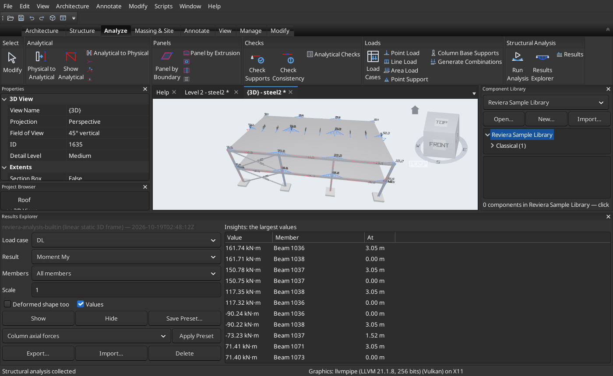

# BIM Reviera

## Open-source BIM on native IFC. Build anywhere, even from the beach.

Reviera is a parametric Building Information Modeling application for architecture,
structure and MEP. Your model is an ordinary IFC file, not a proprietary container.
Every tool is a command that the ribbon, Lua scripts and AI agents share.

**[Get started](get-started.md)** · **[See it in action](screenshots.md)** · **[What it does](features.md)** · **[Source on GitHub](https://github.com/Rational-Boxes/NoDesk_Reviera)**

> **Pre-release.** Reviera is in early development. It already models a small building end to
> end, frames, details and analyses a steel, timber or concrete structure, lays out air,
> plumbing, fire protection and electrical systems, and draws plans, sections, elevations and
> sheets. Pre-release 3 (0.1.0-pre.3) packages are available for Linux (Flatpak) and Windows.

---

## Why Reviera

### Your model stays yours

IFC is Reviera's native format: IFC2X3, IFC4 and IFC4X3. Walls, floors, roofs, beams and
connections are saved as ordinary IFC entities that other tools can read. Files you bring in
from elsewhere survive the round trip intact. There is no lock-in and no export step.

### Scriptable from the ground up

Every operation is a command with a published schema. Run it from the ribbon, from a Lua
script, or let an AI agent drive it through the built-in Model Context Protocol (MCP) server.
Scripts and agents get the same undo, warnings and permission checks as you do.

### Architecture and structure in one model

Draw walls, roofs and stairs. Then frame the building with columns, beams, braces and trusses,
place steel connections, build the analytical model, apply loads and run an analysis. It all
happens in the same file and the same window.

---

## A look inside

*The Manor sample: dormer, spiral stairs and shaped windows, seen through the walls.*

*A steel-framed office, analysed by the built-in solver. The Results Explorer lists the largest
moments while the 3D view draws the diagrams.*

*A Greek temple: 46 columns from a Component Library, placed by one parametric path array.*

[More screenshots →](screenshots.md)

---

## What you can do today

- **Model buildings:** straight and curved walls, doors and windows, floors, ceilings and
  decks. Hip, gable, arched and domed roofs with eaves and dormers. Stairs, railings with
  gates, rooms, levels and grids.
- **Reuse components:** Component Libraries of ordinary 3D files and IFC components, placed
  like stamps, made from any selection and repeated along paths.
- **Coordinate:** find overlaps and resolve them with kept booleans. Run clash detection.
  Check door clearances. Exchange viewpoints with BCF.
- **Frame and analyse structures:** steel and timber sections, trusses and foundations.
  Library steel connections (shear plates, end plates, base plates, gussets), placed one by
  one or automatically from rules. The analytical model, loads, combinations, a linear static
  solver and a Results Explorer.
- **Document:** plans, ceiling plans, sections, elevations, schedules and sheets, exported to
  PDF and COBie.
- **Automate:** Lua scripts and plugins with input forms, and an MCP server for AI agents.

[The full feature list →](features.md)

---

## Built in the open

Reviera is free software under the **GNU GPL v3.0 or later**. Its open data formats and
protocols are MIT-licensed, so any tool can adopt them, whatever its licence.

Reviera is an independent, original application. It does not copy or clone any existing
product, and it does not read or write any product's closed, proprietary formats. IFC is its
native format, and DWG and DXF are exchanged only through open-source libraries.

**[Get started →](get-started.md)**
