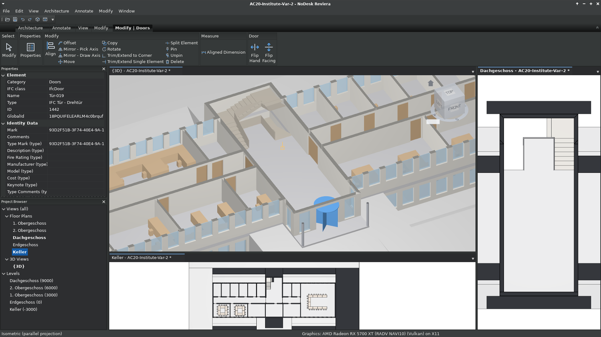
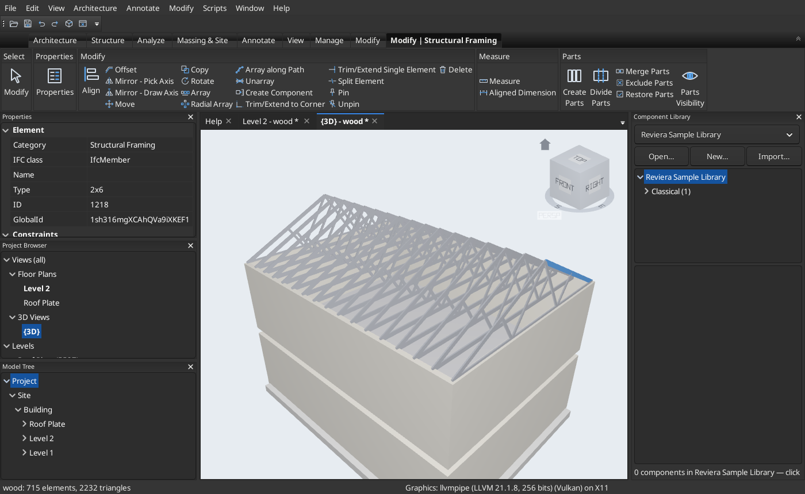

# Screenshots

[← Home](index.md)

All screenshots show Reviera as it runs today, on Linux, in October 2026.

## Architecture

**Select anything, edit it in place.** A door in the KIT FZK *AC20-Institute* sample model,
opened straight from IFC. The contextual Modify | Doors tab and the Properties pane follow the
selection.

**Plans drawn from the model.** The same building's ground-floor plan: cut walls, stairs and
furniture, generated from the 3D model.

**See through it.** The Manor sample drawn see-through in a Hide/Isolate view. The dormer, the
spiral stairs inside the tower, the porch columns and the shaped windows show through the walls.

**Components and parametric arrays.** 46 Doric columns from the sample Component Library,
placed round the stylobate by one path array. Select the array and its own parameters (count,
path, distribution) are ready to edit.

## Inspecting and coordinating

**Section boxes.** Cut a model open to work inside it. Clipping planes round-trip through BCF.

**Many views at once.** Tile plans, sections and 3D views side by side. A change in one shows in
all of them.

**Clash detection.** A clash test of every element against every other ran out of process and
found 19 clashes among 201 bodies. Pick one and the 3D view frames it, ready to review, comment
on or resolve.

## Structure

**Wood framing and trusses.** The wood-frame sample: platform-framed walls under gable Fink
trusses. A 2×6 top chord is selected, with the Modify | Structural Framing tab open.

**Analysis and results.** A two-storey steel office frame, run through the built-in linear static
solver. Bending moments are drawn on every member, and the Results Explorer lists the largest
values by member and position, for any load case or ASCE 7 combination.

---

[What Reviera does →](features.md) · [Get started →](get-started.md)
